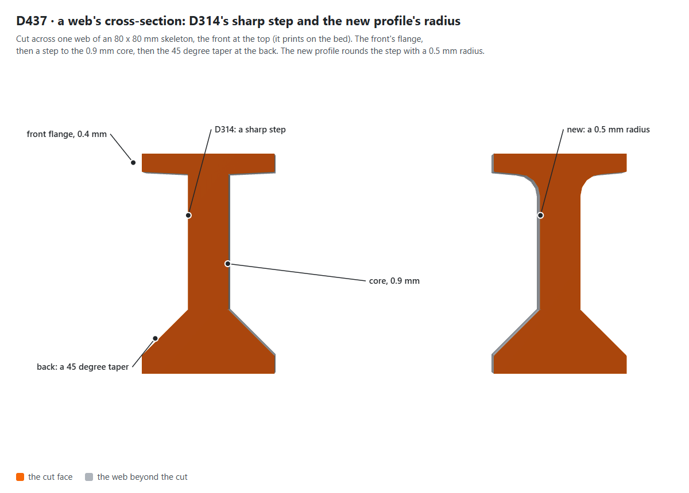
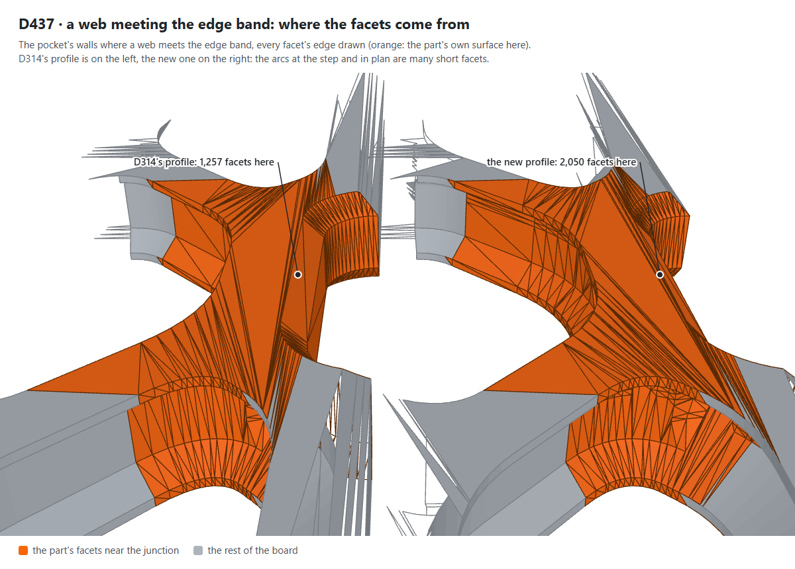
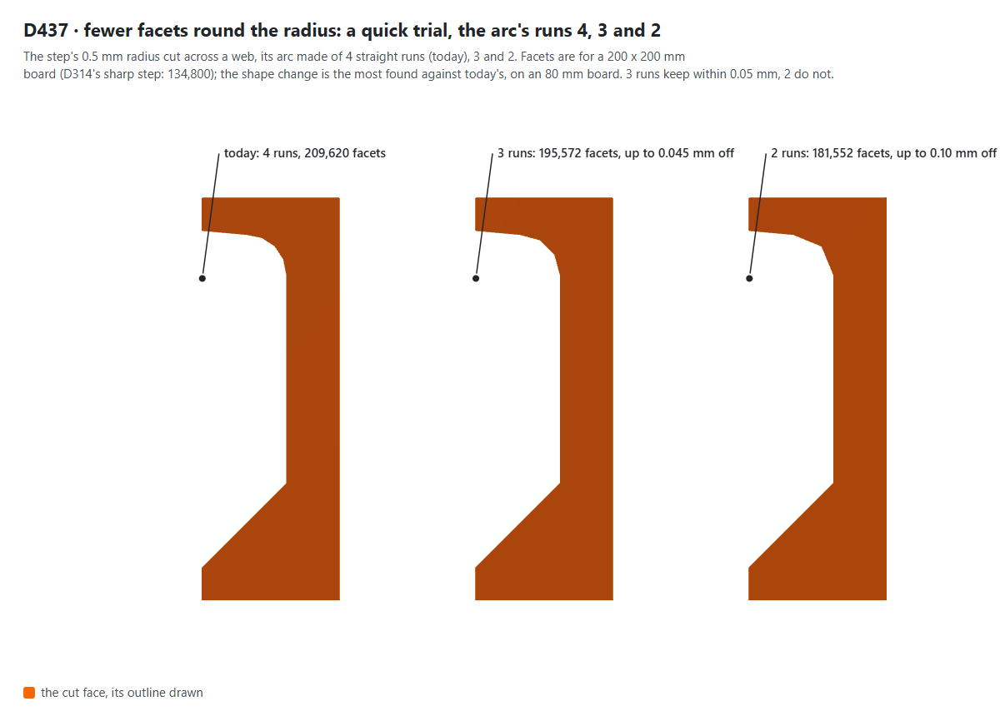
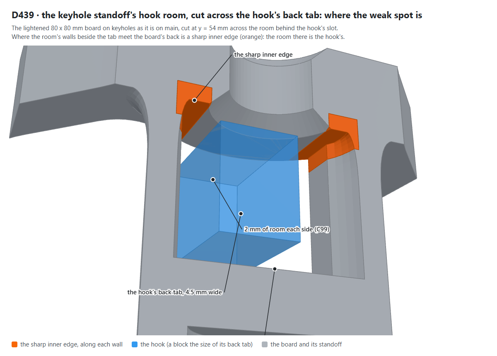
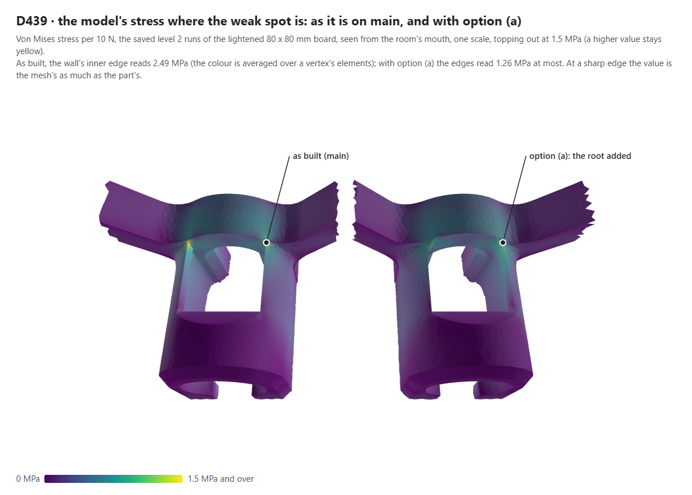
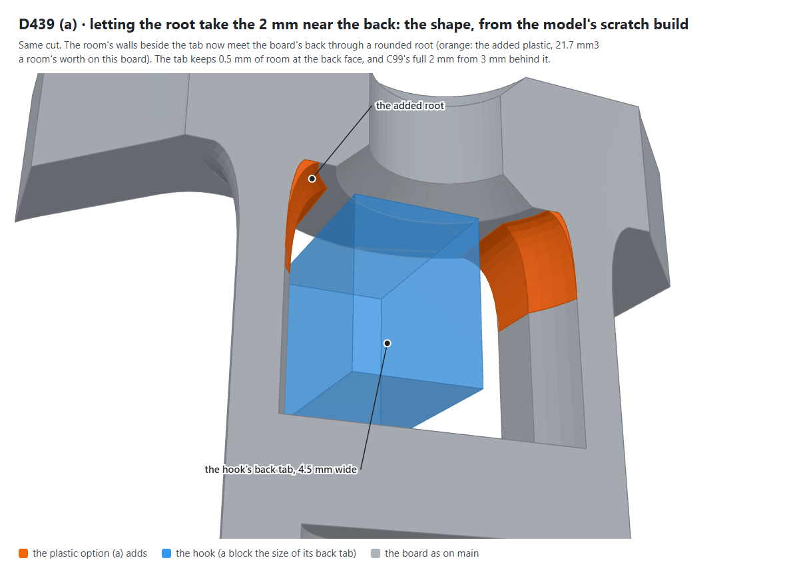
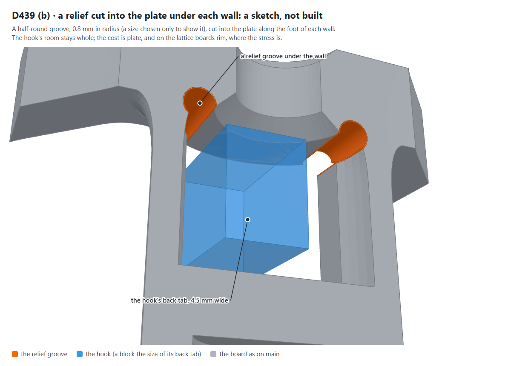
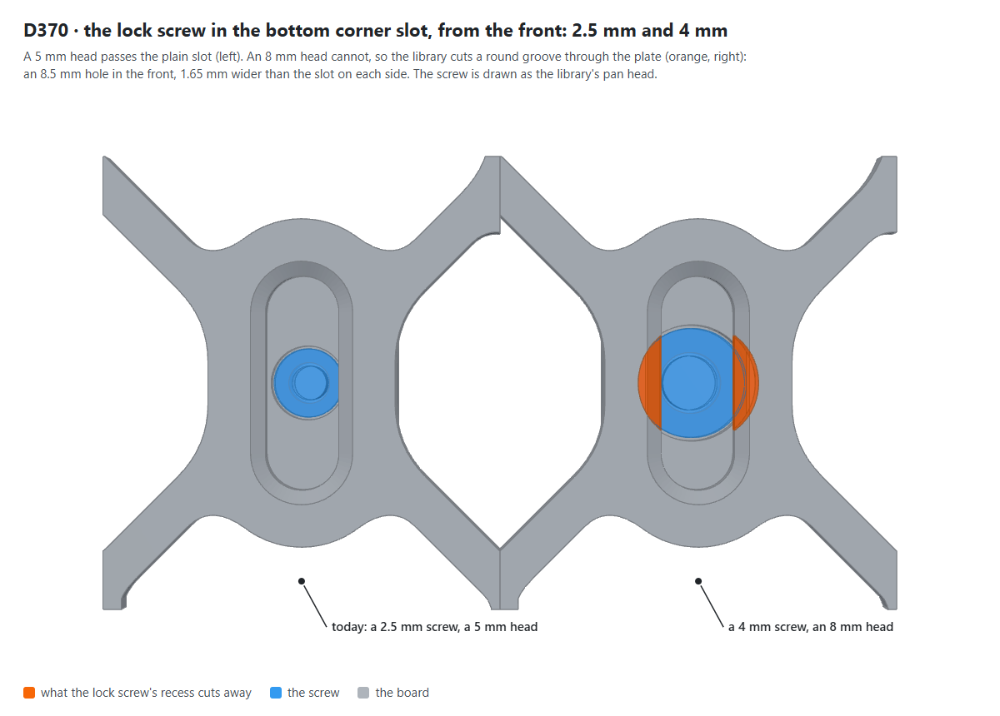
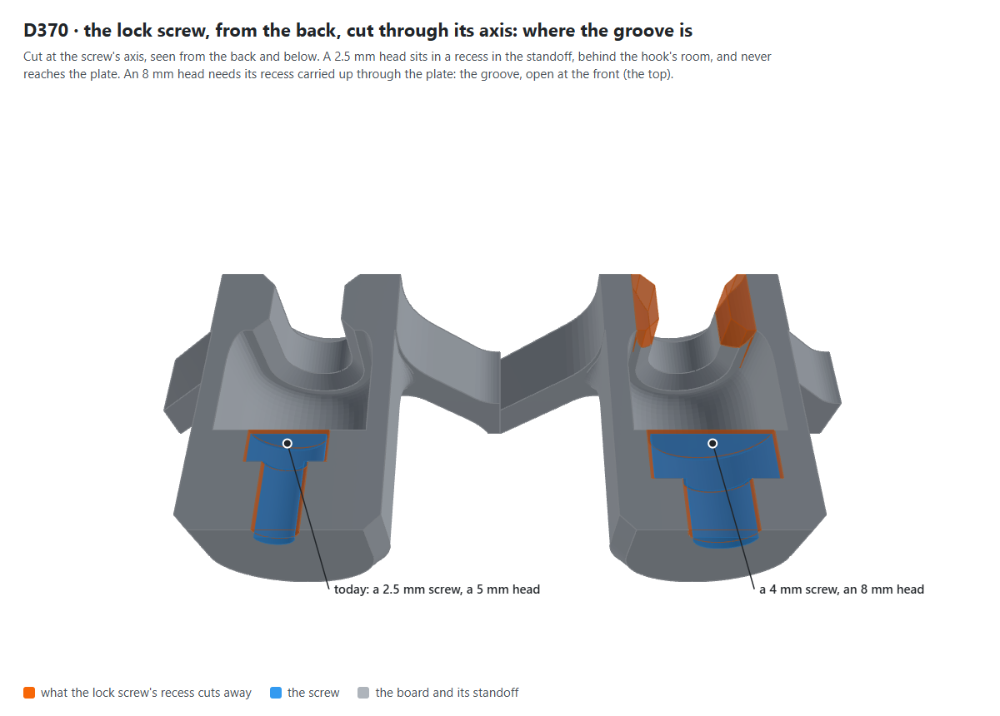

# Three open questions, explained (24 Oct 2026)

Pictures for D437, D439 and D370's consequence, drawn by `scripts/figures/explain.mjs` from the library's own parts
(the place a picture is about is orange). Nothing here changes a design: the questions are still the owner's.

## D437: the reworked skeleton builds about twice as slowly

The reworked skeleton is the branch `feat/skeleton-rework-r2b` (D408 a): D314's profile with a 0.5 mm radius at the step
behind the front flange and a 1 mm radius in plan where the edge band meets a web. `main` still builds `v0.4.2`'s skeleton.



**What it shows:** one web of an 80 x 80 mm skeleton, cut across: the 0.4 mm front flange, the step to the 0.9 mm core and
the 45 degree taper at the back. The new profile rounds the step with a 0.5 mm radius, which is where the extra facets begin.



**What it shows:** the same place on both profiles, where a web meets the edge band, with every facet's edge drawn: 1,257
facets in this window for D314's profile, 2,050 for the new one. Both radii turn a few long facets into many short ones.



**What it shows:** the option (b) asks for, tried the quick way: the arc's straight runs cut from 4 (today) to 3 and to 2.
It is simple to try but gains little (below), so this is a picture of why it does not get you to twice as fast.

### What was measured

All with the library built from each branch, in Node, on one machine that other work also used, so the times are
noisy (each is a median of 3 builds after 1 warm-up, in its own process; the table gives the range of the medians over two
rounds). A build is `buildBoard` and then `numTri()`, because Manifold evaluates lazily. The sizes are the board's width and height.

| Build | Facets, 200 x 200 mm | Time, 200 x 200 mm | Facets, 400 x 400 mm | Time, 400 x 400 mm |
|---|---|---|---|---|
| `main` (`v0.4.2`'s skeleton) | 124,314 | 2.4 to 2.7 s | 493,040 | 12.9 to 15.2 s |
| the branch, D314's profile (no radii) | 134,800 | 3.0 to 3.2 s | 534,984 | 14.3 to 16.0 s |
| the branch, as it is (both radii) | 209,620 | 5.6 to 6.5 s | 786,030 | 30.0 to 32.9 s |

The 400 x 400 mm facets are the owner's (786,030 and 534,984), now measured here too. Where they come from, 200 x 200 mm:

| Profile | Facets | Time (medians of two rounds) |
|---|---|---|
| no radii (D314) | 134,800 | 3.1 to 3.2 s |
| the step's radius only | 196,626 | 3.3 to 4.2 s |
| the band's radius in plan only | 141,710 | 5.1 to 6.6 s |
| both (as it is) | 209,620 | 5.6 to 6.5 s |

- **The step's radius adds the facets** (62,000 of the 75,000 extra, about 83 %), **verified** by building without each.
- **The band's radius adds the time**: 7,000 facets, but about 2 to 3 s of the 2.4 to 3.3 s extra, which is not what the
  facets suggest. Its cause is likely (inferred, not profiled) that the band's edges are cut every 0.125 mm for the rolling
  ball (`finerBand`), so the pockets' outlines carry thousands of points through every level of the loft. It changes what
  option (b) would have to aim at.

### The quick trial for option (b) (not kept: nothing was committed to the branch)

Each is a one-constant change in a scratch build. The shape change is measured against today's build on an 80 x 80 mm board,
in sections along two directions, 216 and 296 of them, which gives an upper bound of the distance between the two surfaces
(the 0.05 mm limit is the owner's).

| Trial | Facets, 200 mm | Time, 200 mm | Largest shape change |
|---|---|---|---|
| the arc in 3 runs (4 today) | 195,572 | 5.9 s | 0.045 mm |
| the arc in 2 runs | 181,552 | 5.4 s (one round 23 s, a busy machine) | 0.10 mm, past 0.05 mm |
| the band cut every 0.25 mm (0.125 today) | 203,076 | 4.9 to 5.5 s | 0.31 mm at the worst place found |
| the band cut every 0.5 mm | 199,842 | 4.6 to 5.2 s | 0.2 mm or more (the search's limit) |

So: fewer arc runs keep the shape within 0.05 mm only at 3 runs, which takes 7 % off the facets and nothing measurable off the
time; coarser band cuts take 10 to 20 % off the time but move the band's side by about 0.3 mm where it meets a web. Neither
halves the build. Getting there would be a change to how the band's rounding is made (fine cuts only within a radius of
a junction, not along the whole band), which is more than a quick trial and is not drawn.

## D439: the keyhole boards' weak spot



**What it shows:** the lightened 80 x 80 mm board on keyholes, as it is on `main`, cut across the room behind a hook's slot.
The room is the hook's back tab (4.5 mm, drawn as a block, not the hook) with 2 mm each side and 8 mm of depth; where each
wall meets the board's back there is a sharp inner edge (orange), left that way because the 2 mm is the hook's room (C429).



**What it shows:** the physics model's von Mises stress per 10 N, level 2, read from the saved runs: the sharp edge is the
brightest place as built, and the same edges are quiet with option (a). A sharp edge has no converged value (the report says
so): the modelled capacity in PLA is 133 N as built (an upper bound) and 215 N with option (a) (its mesh not converged).



**What it shows:** option (a), from the model's scratch build `d411-tab-a` (on no branch): the root takes the 2 mm near the
back, and the tab keeps 0.5 mm of room at the back face. The orange is the 21.7 mm3 it adds. It needs the hook's tab measured
first (its 4.5 mm width is unmeasured, T373, D414).



**What it shows:** a sketch of option (b), not built, its 0.8 mm radius chosen only to show it: a half-round groove cut
into the plate along the foot of each wall, so the room stays whole and the plate pays for it. Option (c) is the first picture,
left as it is until a hook is measured.

## D370's consequence: the same screw everywhere

The owner's answer is that a screw choice is made across all the screw locations (so the lock screws take the keyholes'
4 mm). The 4 mm countersunk screws have 8 mm heads (Q359), and the library cuts a lock screw's recess for a pan head twice the
screw's size across: 5 mm for the 2.5 mm screw of today, 8 mm for a 4 mm one. The screw drawn is that pan head, not the
owner's countersunk one.



**What it shows:** from the front, a 5 mm head passes the plain slot (left). An 8 mm head cannot, so the library cuts a round groove
through the plate (orange, right): an 8.5 mm hole in the front, 1.65 mm wider than the slot on each side, so a board with its
screws all 4 mm shows two such rounds on its front at the bottom corners.



**What it shows:** from the back and below, cut through the screw's axis: the head sits in a recess in the standoff behind the
hook's room, and for 4 mm the recess is carried up through the plate on both sides of the slot (the orange columns), which is
the groove. The choice is whether the groove, an 8.5 mm round on the front of the board, is acceptable.

## Reproducing

```bash
npm run build -w skadis-air      # the library, in this checkout and in one of feat/skeleton-rework-r2b
uv run scripts/figures/explain-stress.py <physics .check folder> .check/figures/explain-stress.json 1.5 d411 d411-tab-a
SKADIS_R2B_REPO=<the r2b checkout> SKADIS_PHYSICS_DIR=<the physics .check folder> \
  node scripts/figures/shoot.mjs explain
```

The D437 trials were scratch builds of one constant in `packages/core/src/skeleton.ts` of that branch (`ARC_RUNS`, and the
divisor in `finerBand`'s call), built into `.check/dist-trial*` beside it, with the source put back after each.
