# The page's Sides control and the Printables cover, as asked (30 Oct 2026)

Pictures for D528, D529 and D531: the page's controls as they are on the development build, a mockup drawn in the
design system's own styles, and a frame of the cover animation as the branch `feat/cover-looks` draws it.

## D528: the Sides control

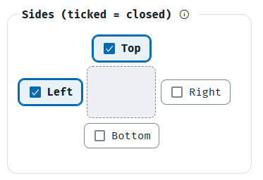

**What it shows:** today's control, Top and Left ticked (closed): the square in the middle does not change.

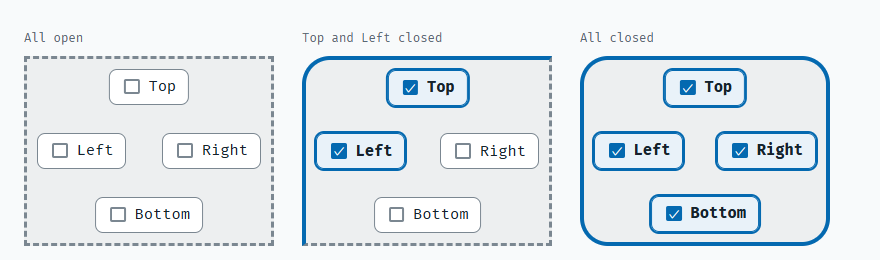

**What it shows:** the proposal, a mockup and not the page: all open, Top and Left closed, all closed. A closed side is a
solid blue edge, an open one dashed grey, and a corner is round where both its sides are closed, as the board is built.

## D529: where Open sides goes

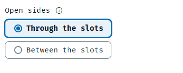

**What it shows:** the Open sides choice as it is today, after Thickness and Sides.

## D531: the cover

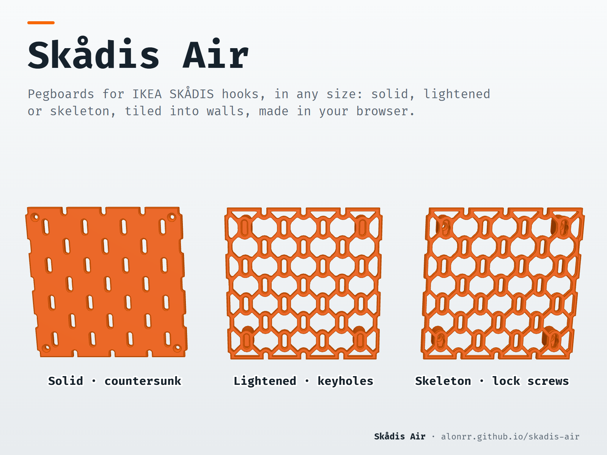

**What it shows:** the cover's first frame, each lattice board cut across its middle: Curved above, Straight below.

## Q530: the open sides' two kinds

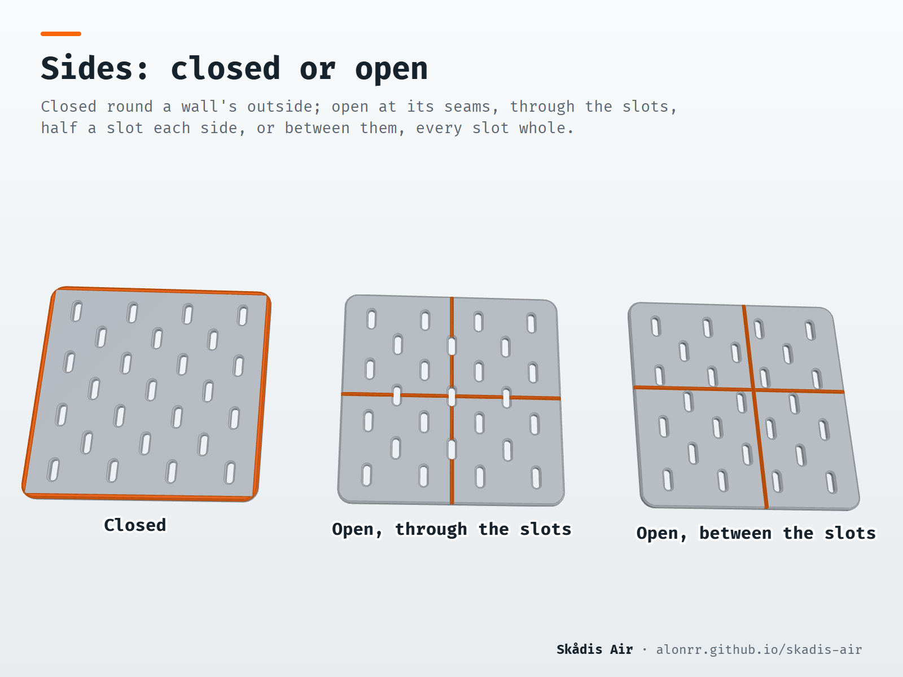

**What it shows:** `sides.png` as the gallery draws it, sixth on the Printables page since 23 Oct 2026: the two kinds of
open side the owner asked to show.

## Q588: where Width, Height and Thickness are

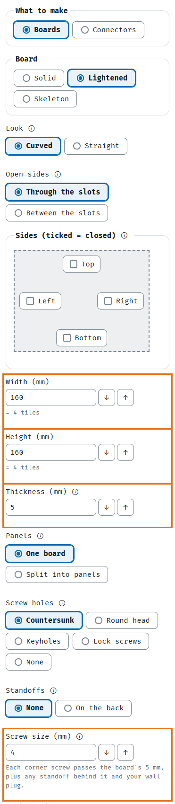

**What it shows:** the form as `main` and the `v0.9.0` release lay it out on every screen width: Width, Height and
Thickness (outlined) already come before Screw size (outlined), with Panels, Screw holes and Standoffs between them.

## D589: Standoffs with keyholes or lock screws

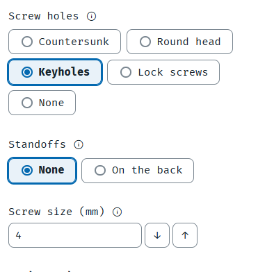

**What it shows:** today: Keyholes chosen, then None clicked under Standoffs. The form shows nothing there; the line
above the download button says the board cannot be made, and the error sits on Standoff height, under Advanced.

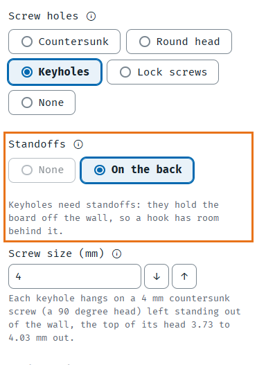

**What it shows:** option (a), a mockup on the page: None greyed out and a note saying why.

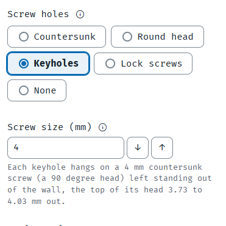

**What it shows:** option (b), a mockup on the page: the Standoffs choice gone while Keyholes or Lock screws are chosen.

## D590: Panels in What to make

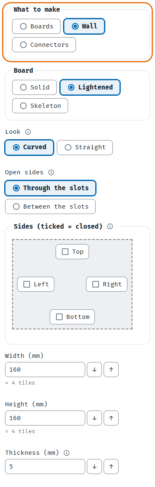

**What it shows:** a mockup on the page: Wall as a third choice in What to make, and the Panels field gone from the form.

## D591: the cover's line between the looks

**What it shows:** option (a), frame 30 of the cover: a dashed grey line across each lattice board alone, never across
the gap between them.

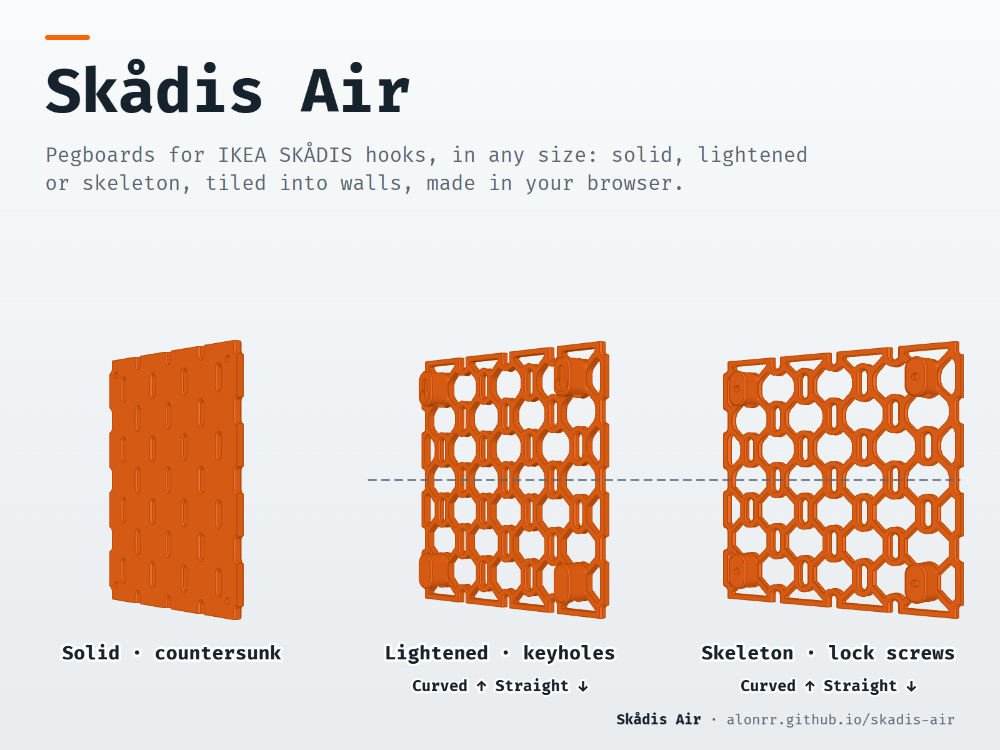

**What it shows:** option (b): today's one line across both boards, dashed and in the text's grey, ending at the boards'
outer edges rather than the picture's.

**What it shows:** option (c): no line over the boards, a short orange mark in each gap at the cut, in the title bar's
orange.

## D592 and D593: the nut standoff and the tape standoffs

**What it shows:** sketches, not the parts: D592 (a) a nut in a pocket under the board, a countersunk M4 machine screw
through the board's corner hole into it; D592 (b) a bolt through the board, the standoff and a panel, the nut behind;
D593 a board's corner standoffs ending in pads for double-sided tape.

## D591 again: three more ways, after "591 still not good"

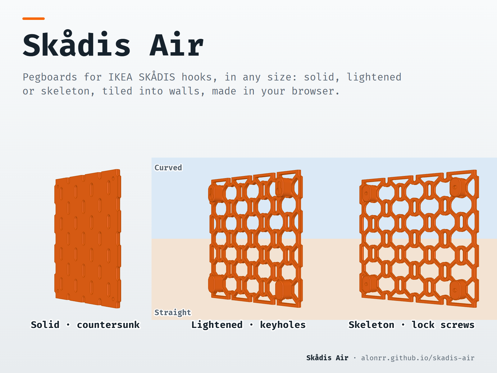

**What it shows:** option (d), frame 30: no line; behind the lattice boards a backdrop in two tones, the cut where they
meet, "Curved" and "Straight" written in them.

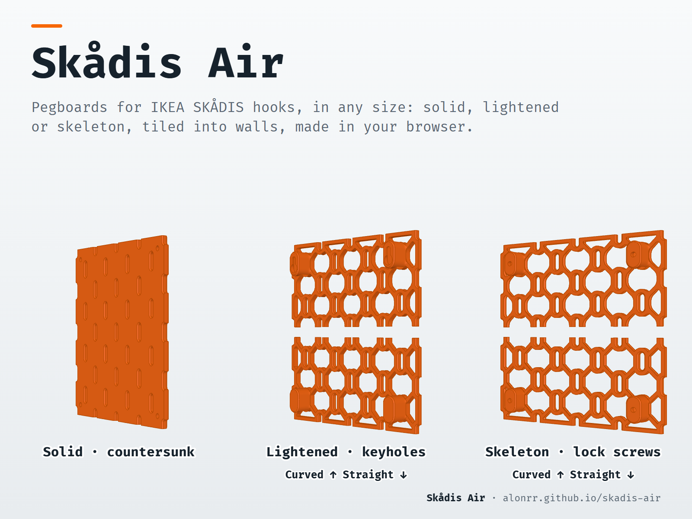

**What it shows:** option (e): no line; each lattice board's Curved half and Straight half moved 10 mm apart, so the cut
is a gap in the part itself, level in every frame.

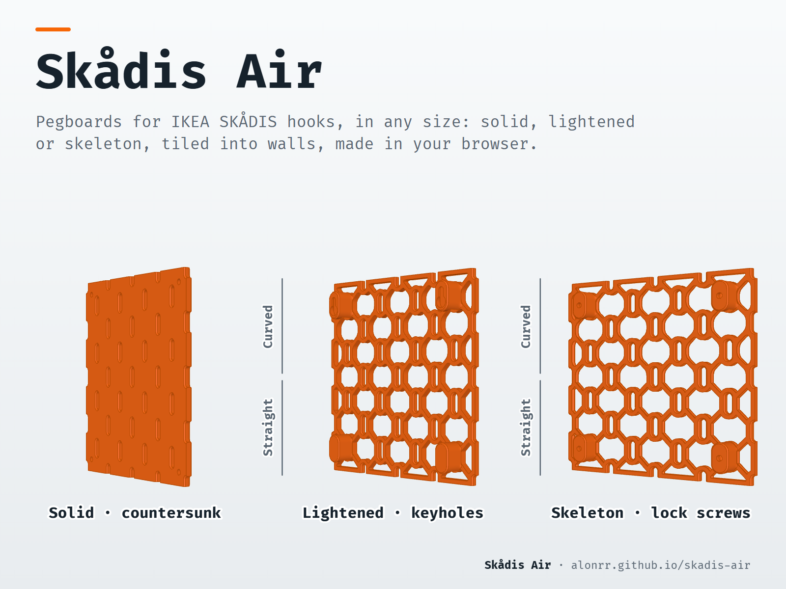

**What it shows:** option (f): no line over the boards; beside each lattice board a bracket for each half, its look
written along it, the break between the brackets at the cut.

## D592 and D593 as built

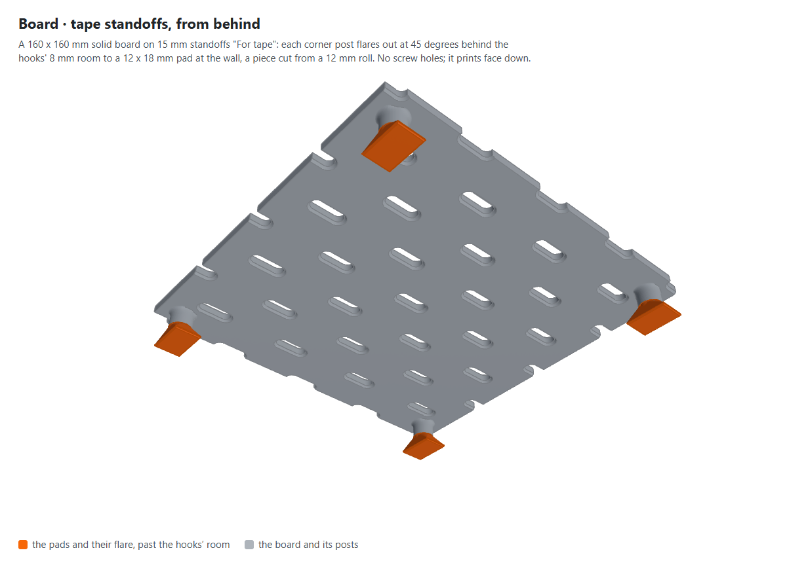

**What it shows:** a 160 x 160 mm solid board on 15 mm standoffs "For tape", from behind: each corner post flares out
at 45 degrees behind the hooks' 8 mm room to a 12 x 18 mm rectangular pad, a piece cut from a 12 mm roll, in orange
(C601; it was round, 19 mm across, before the owner's "The tape designs should be rectangular"); no screw holes. Drawn
by `node scripts/figures/shoot.mjs tape-nut`, the library's own part.

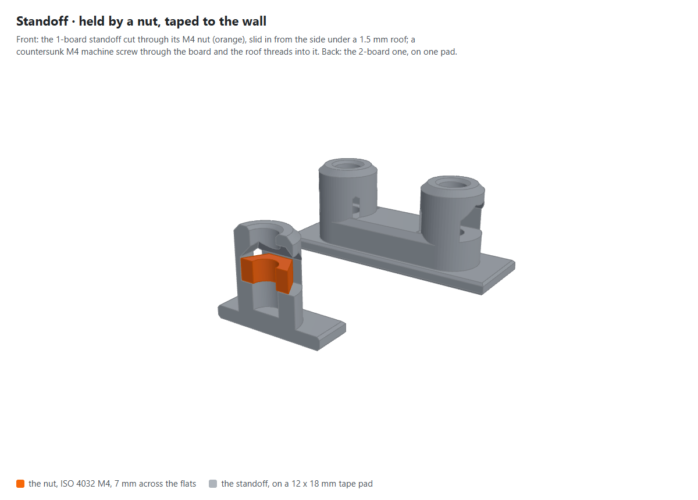

**What it shows:** the 1-board standoff "Nut, taped to the wall", cut through its M4 nut (orange), which slides in from
the side under a 1.5 mm roof; behind it the 2-board one whole, on one tape pad, each post's pad a 12 x 18 mm piece. The
same pass.

## D600: the nut standoff screwed to the wall

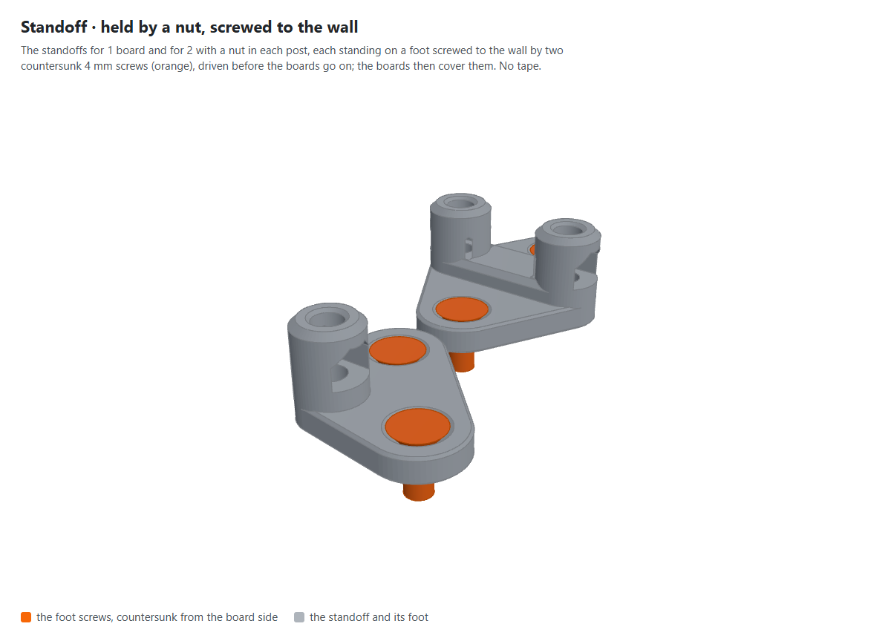

**What it shows:** "Nut, screwed to the wall" (D600), for 1 board and for 2: a nut in each post as above, each standing
on a 4 mm foot screwed to the wall by two countersunk 4 mm screws (orange), driven before the boards go on, which then
cover them; no tape. The same pass.

## D591: as chosen

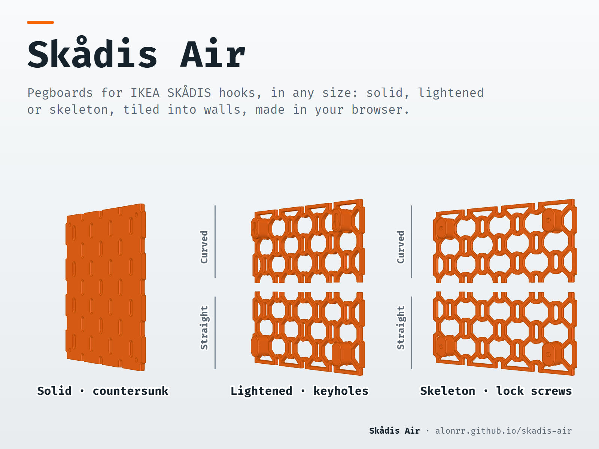

**What it shows:** frame 30 of the cover as built for "591 e with the line on the side from f": the gap at the cut, and
a bar beside each half with its look written along it.
