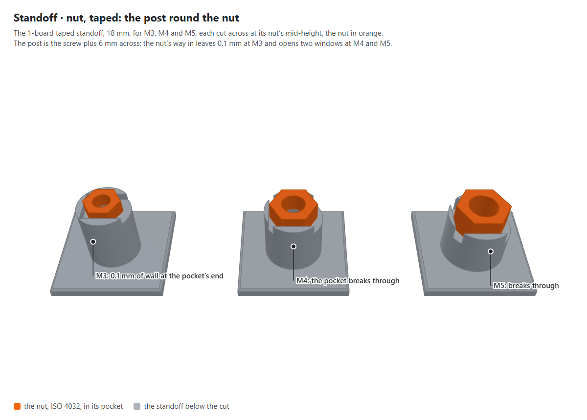
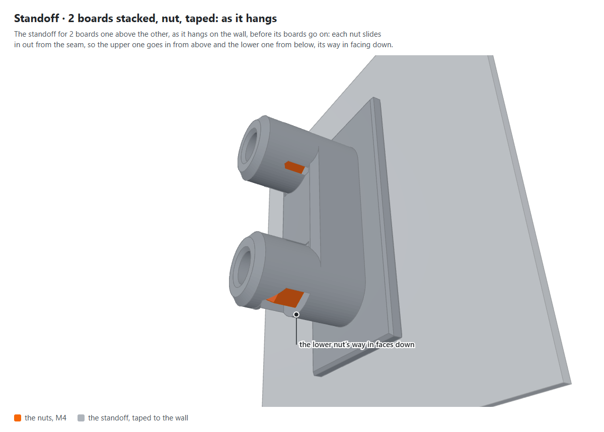

# The nut standoff's engineering pass (30 Oct 2026)

Pictures for D607, the nut's pocket, from [`docs/research/2026-10-30-tape-and-nut-pass.md`](../../research/2026-10-30-tape-and-nut-pass.md).
Drawn by `node scripts/figures/shoot.mjs nut-pass` from the library's own parts at `3bb9801`.

**What it shows:** the 1-board standoff "Nut, taped to the wall", 18 mm, for M3, M4 and M5, each cut across at its
nut's mid-height. The post is the screw plus 6 mm across; the nut's way in leaves 0.1 mm of wall at the pocket's closed
end at M3, and cuts two windows through it at M4 and M5. Beside the nut's corners the wall is 0.9 mm at M4.

**What it shows:** the standoff for 2 boards one above the other, taped up and waiting for its boards: each nut slides
in out from the seam, so the lower one's way in faces down the wall.
