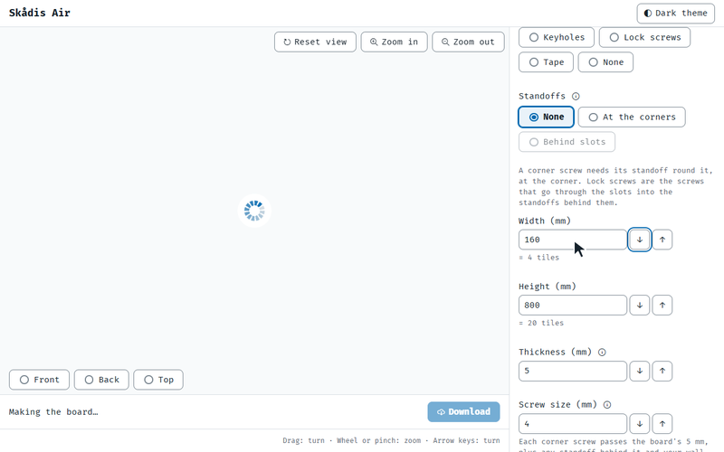
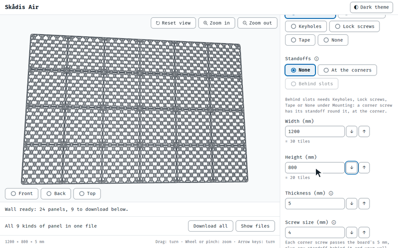

# The text's page GIFs made again (D654)

Pictures for D654, kept here until it closes (the owner's rule, 28 Oct 2026). Each is a frame of the Printables text's
first GIF, `page-in-use.gif`, at the step where the size is set to 1200 x 800 mm for a wall (C653).

The published GIF, recorded 31 Oct 2026: the wall's size is typed, and the 3D view is still making it, a spinner, when
the GIF moves on to 160 mm. The wall was never shown.

Made again on 10 Nov 2026 from the published page (`v0.12.0`), with the script waiting until the page is idle: the
wall in 24 panels, before the next step.
