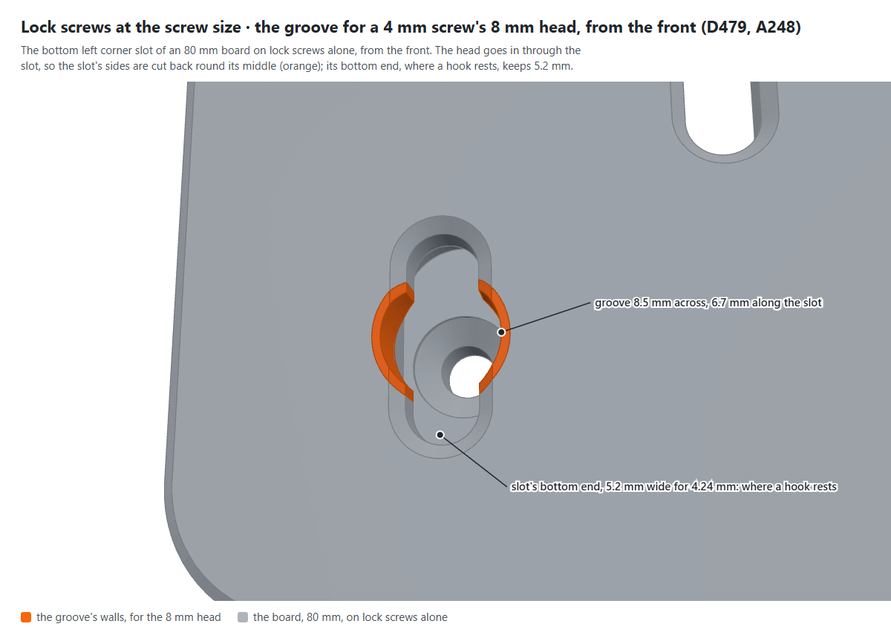
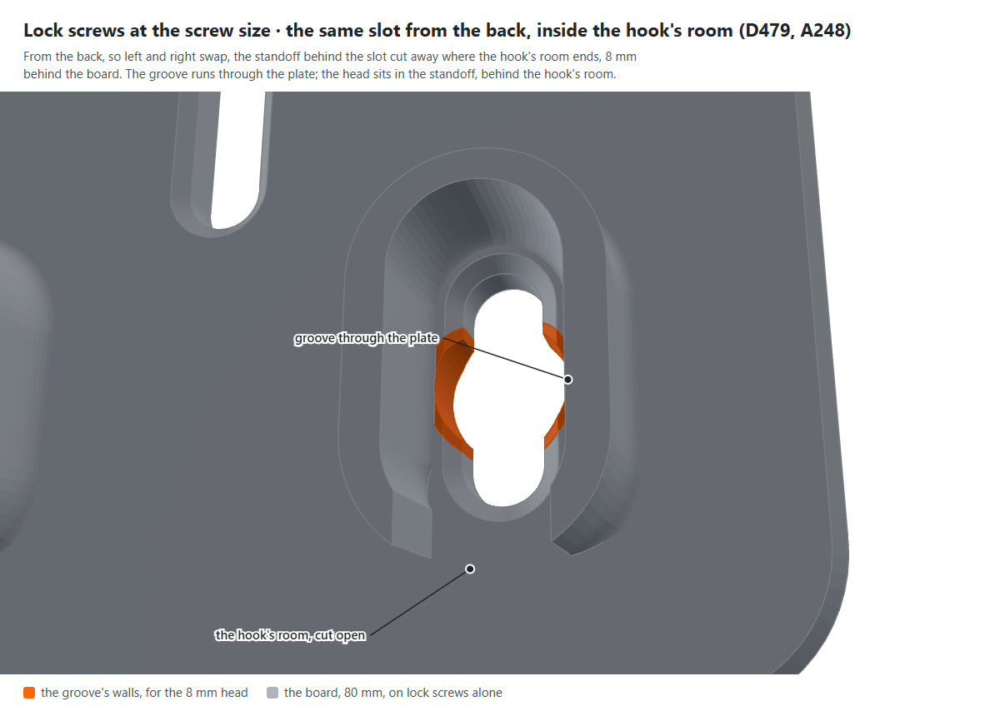
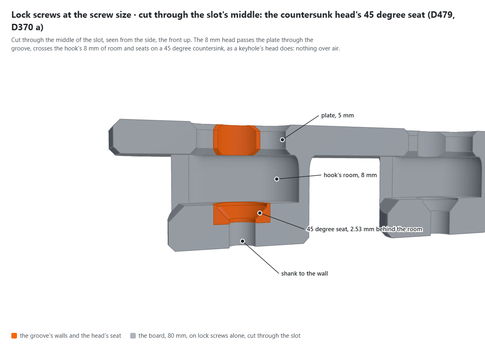
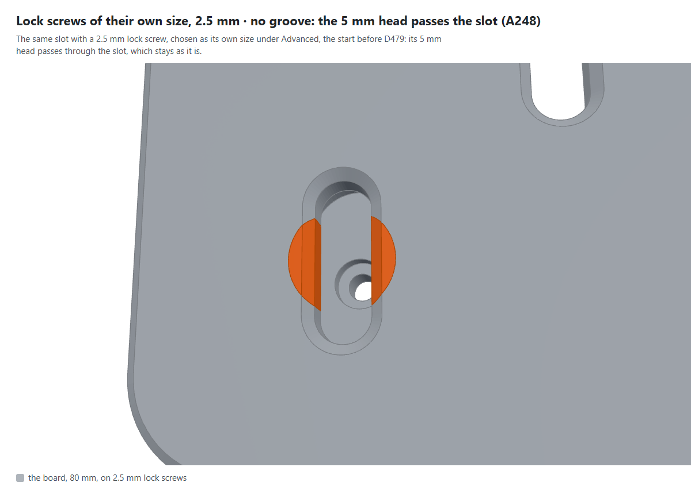
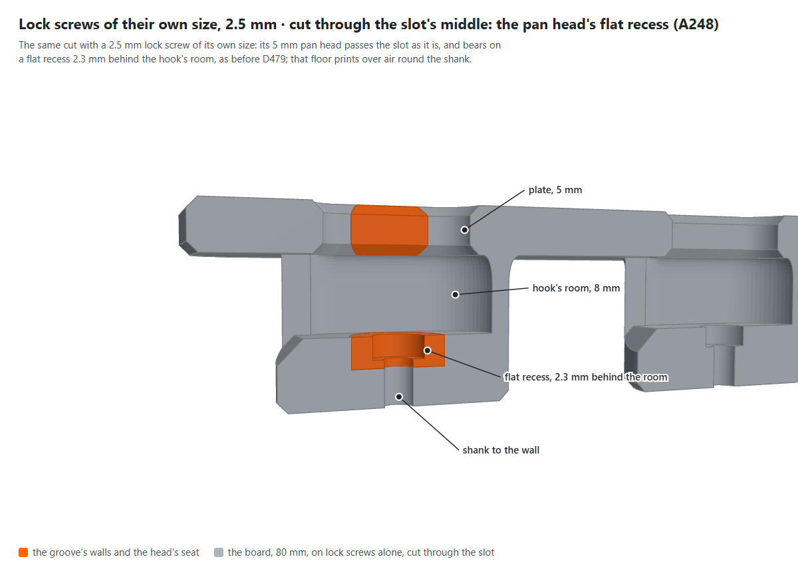

# The lock screws' groove and seat, and the screw settings (D479, Q511)

Pictures for Q511, kept here until it closes (the owner's rule, 28 Oct 2026). The parts are drawn by
`node scripts/figures/shoot.mjs screw-groove` from the library's own boards, 80 x 80 mm, closed all round, on lock screws
alone and 15 mm standoffs, the groove's walls and the head's seat in orange. The form is shot from the built page by
`node scripts/figures/screw-form.mjs`, into [`form/`](form/).

**What it shows:** a lock screw's slot from the front: an 8.5 mm round groove in its sides lets a 4 mm screw's 8 mm head
through the plate, clear of the slot's bottom end, where a hook rests.

**What it shows:** the slot from the back, inside the hook's room: the groove runs through the plate, and the head sits
in the standoff, behind the room.

**What it shows:** cut through the slot's middle: the head passes the plate through the groove, crosses the hook's 8 mm of
room and seats on a 45 degree countersink, nothing over air.

**What they show:** a lock screw of its own size, 2.5 mm, whose pan head passes the slot: no groove, its flat recess kept.

## The screw settings on the page

Shot on 28 Oct 2026 from the page with the design system's v0.9.0, each on a 1280 px screen (`desktop-1280-*`) and a
375 px phone (`phone-375-*`), in [`form/`](form/):

1. `1-main-form-screw-size`: the screw size on the main form, 4 mm, the screw for every hole.
2. `2-advanced-countersunk-all-greyed`: Advanced on a board with countersunk corners: no keyholes or lock screws, so
   their sizes are greyed out.
3. `3-advanced-keyholes-same`: keyholes chosen: their size is "Same as the screw size", their own size greyed out.
4. `4-advanced-lock-screws-own-3mm`: lock screws at the bottom, "Own", 3 mm.
5. `5-slot-clip-main-screw-size`: the slot clip, its own screw size on its main form, set apart from the boards' today
   (Q511).
6. `6-slot-clip-advanced-own`: the slot clip's screw under Advanced, "Own", 3 mm.
