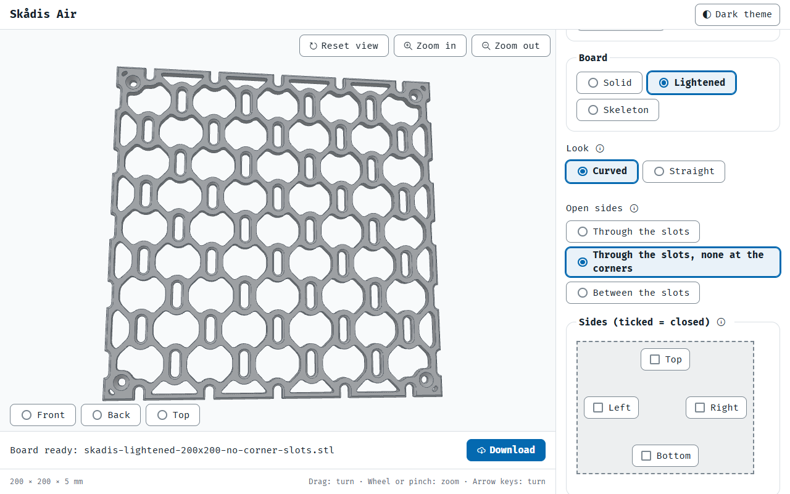
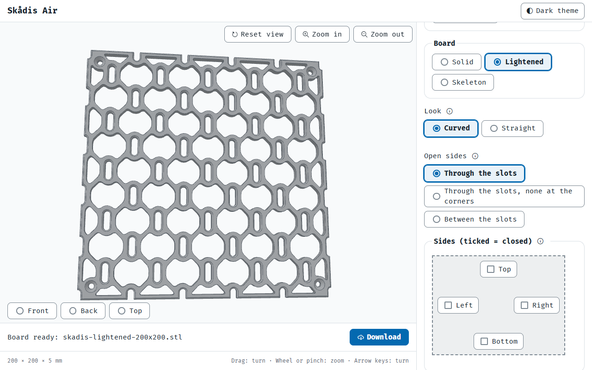
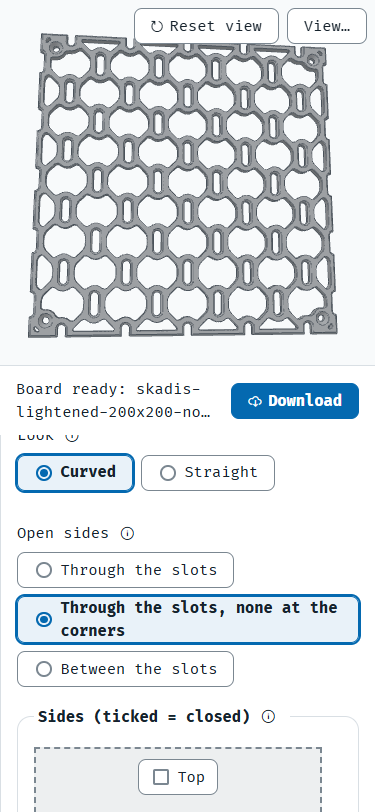

# The second slot pattern's open item (D642)

Pictures for D642, kept here until it closes (the owner's rule, 28 Oct 2026). Shot on the built page, 9 Nov 2026 (D641 a).

**D642:** the new option under Open sides, with the board it makes, 200 x 200 mm.

Today's pattern, the default, for comparison.

The same on a phone: the option's label takes two lines.
