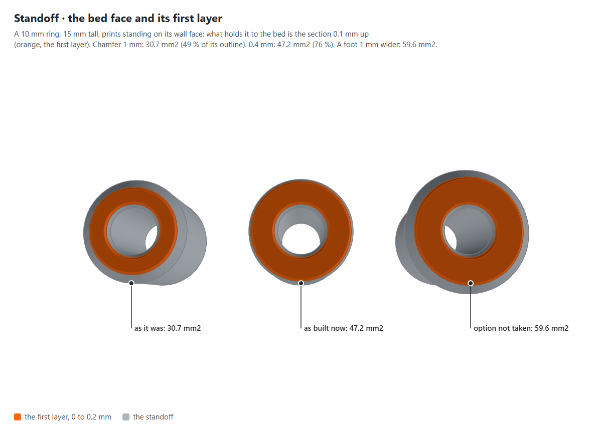
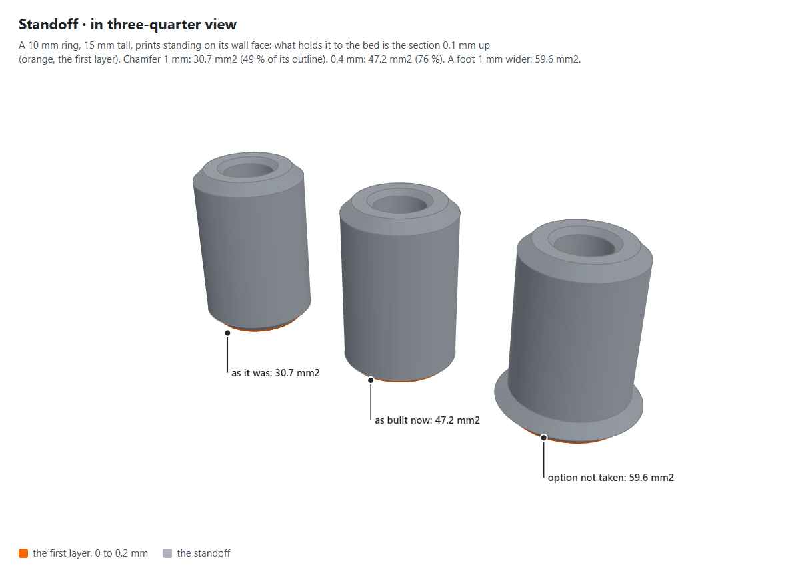
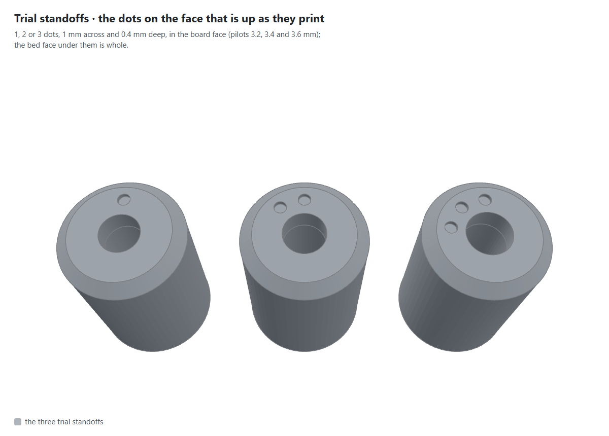

# The standoff's foot (T274)

Pictures for T274, kept here until it closes (the owner's rule, 28 Oct 2026). Drawn by
`node scripts/figures/shoot.mjs standoff-foot` from the library's own standoff, beside the two other feet it was
weighed against (C463 to C469). T274 prints `.check/test-print/skadis-trial-standoffs.stl` without a brim and says which
pilot holds the screw.

**What it shows:** what holds each standoff to the bed, the first layer in orange: as it was, with a 1 mm chamfer on the
bed edge (30.7 mm2); as built now, 0.4 mm (47.2 mm2); and a foot 1 mm wider, the option not taken (59.6 mm2).

**What it shows:** the same three standoffs from the side, so the bed edge's chamfer and the wider foot can be compared.

**What it shows:** the trial's dots, which tell its standoffs apart, moved to the board face, the face that is up as they
print, so the bed face is whole: 1, 2 or 3 dots for the pilots of 3.2, 3.4 and 3.6 mm.
