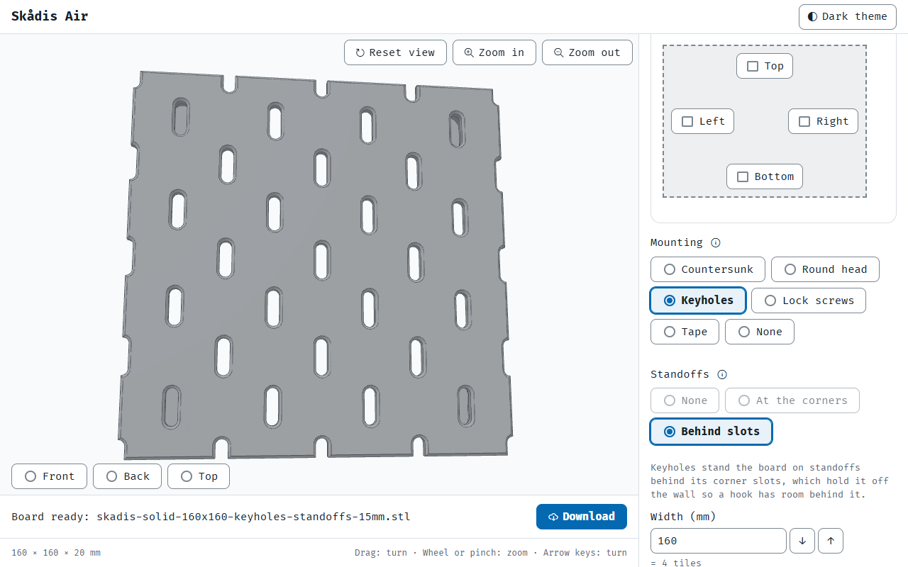
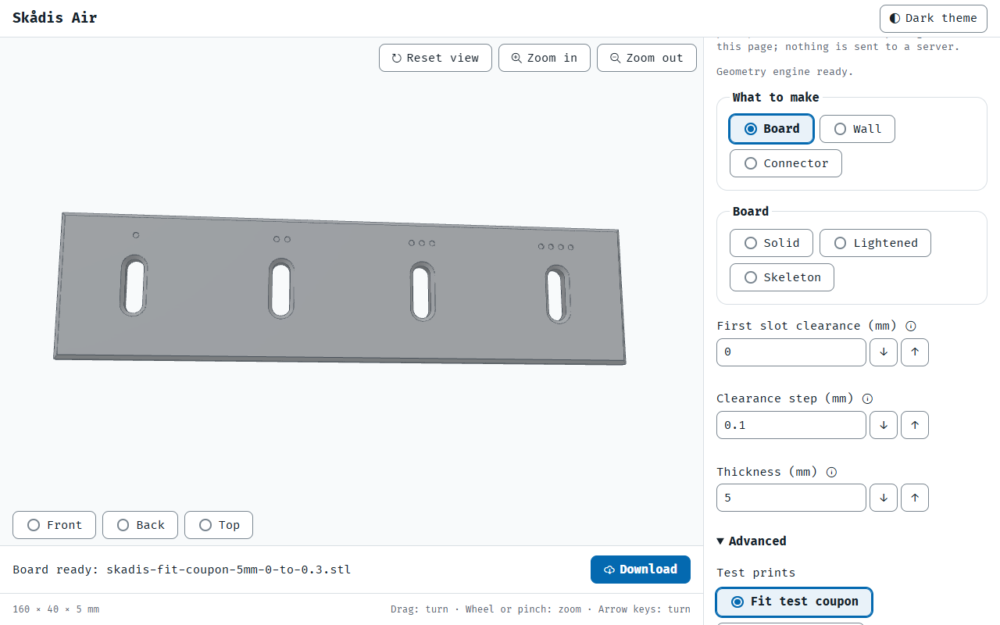

# The settings sweep's open items (D636, D639)

Pictures for D636 and D639, kept here until each closes (the owner's rule, 28 Oct 2026). Shot by
`node scripts/checks/sweep-page.mjs` on the built `v0.11.2` page, 31 Oct 2026 (D633 a).

**D636:** with keyholes (or lock screws, or tape) the Standoffs field shows one choice, Behind slots, the other two
greyed with the reason under them.

**D639:** with a test print chosen under Advanced, the Board list above shows Solid, Lightened and Skeleton with none
chosen.
