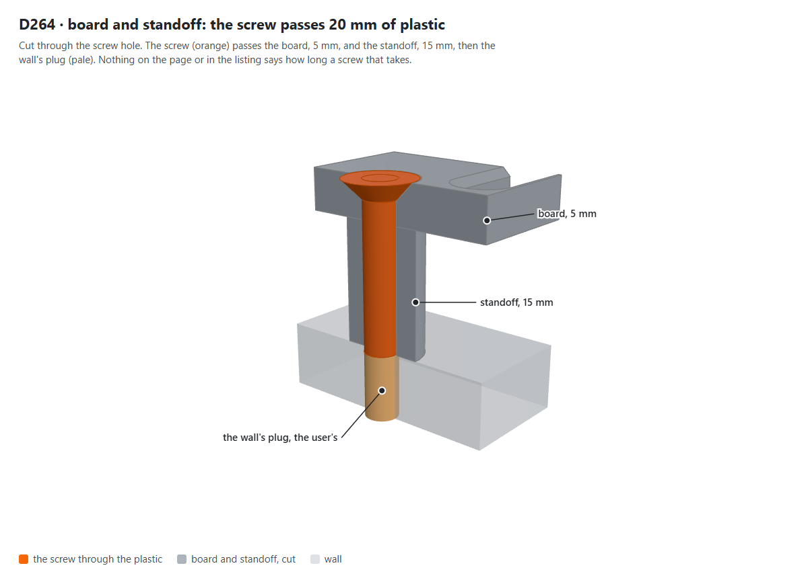
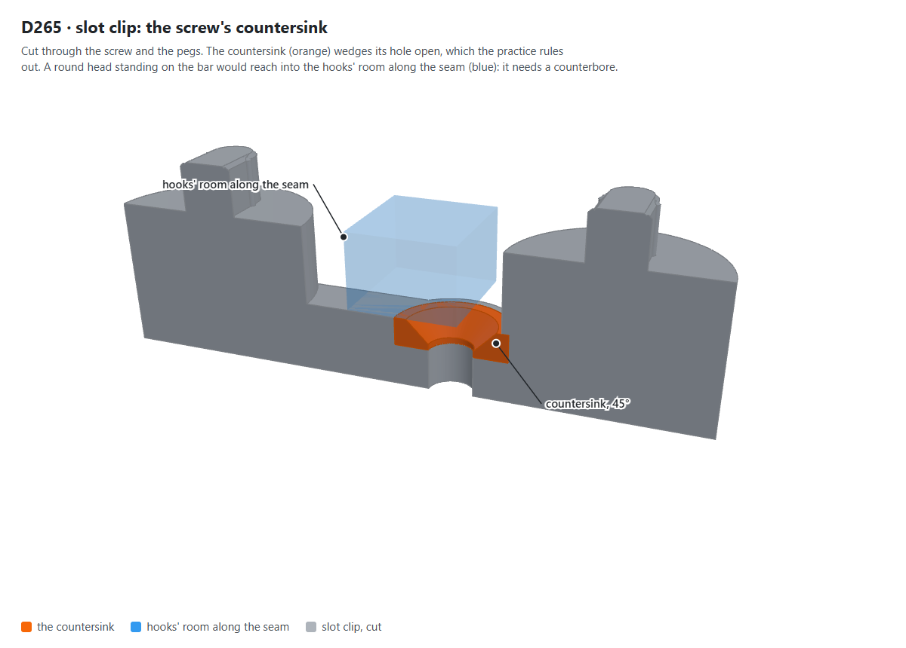
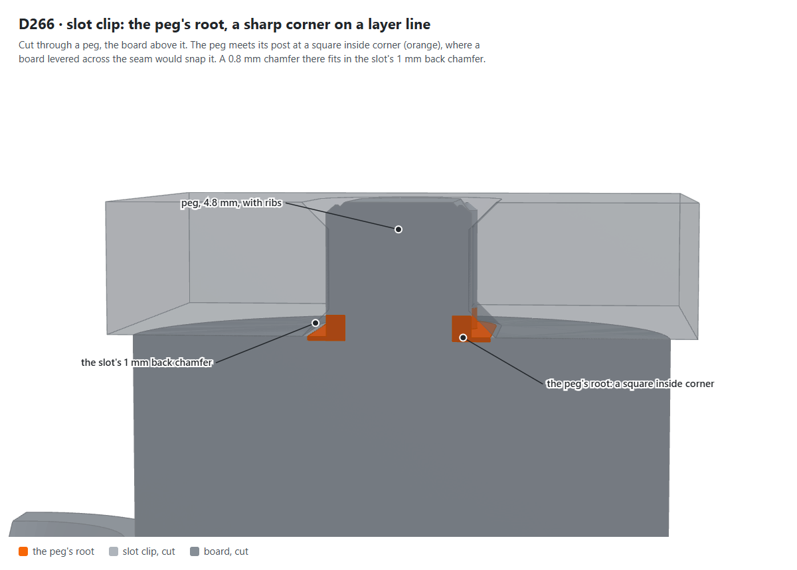
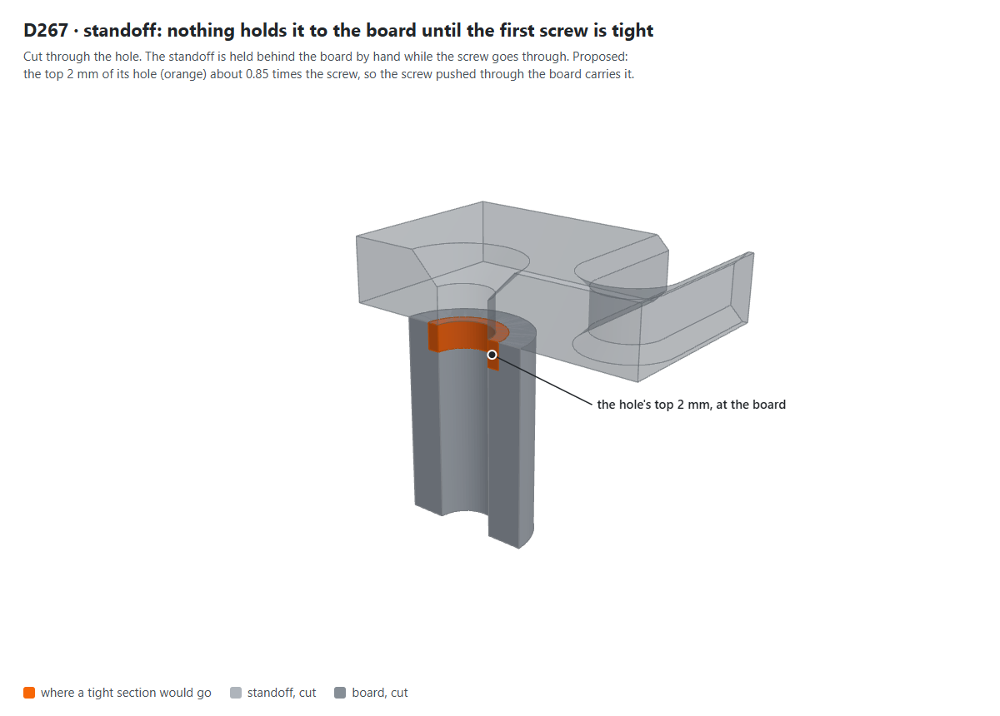
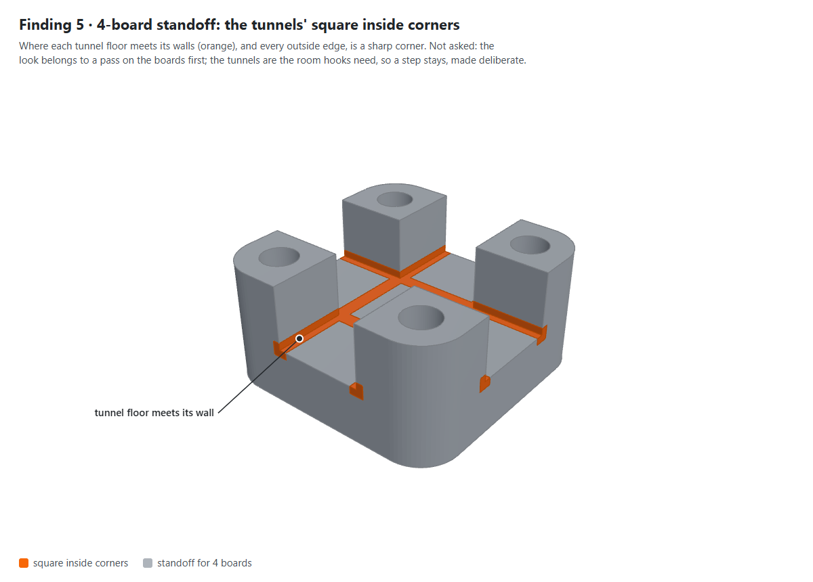
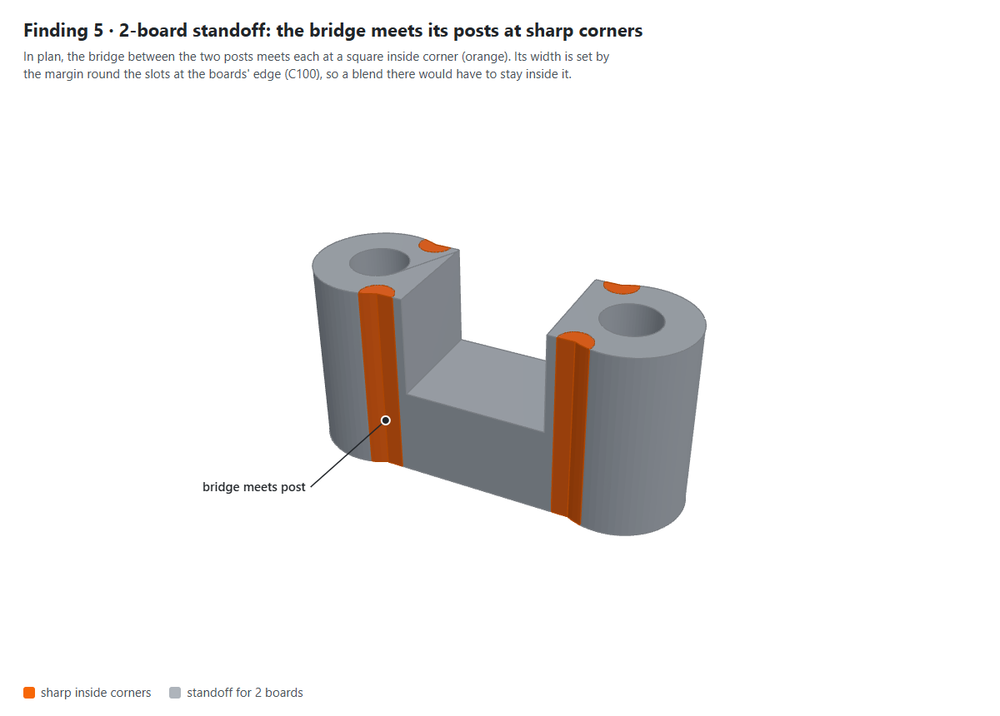
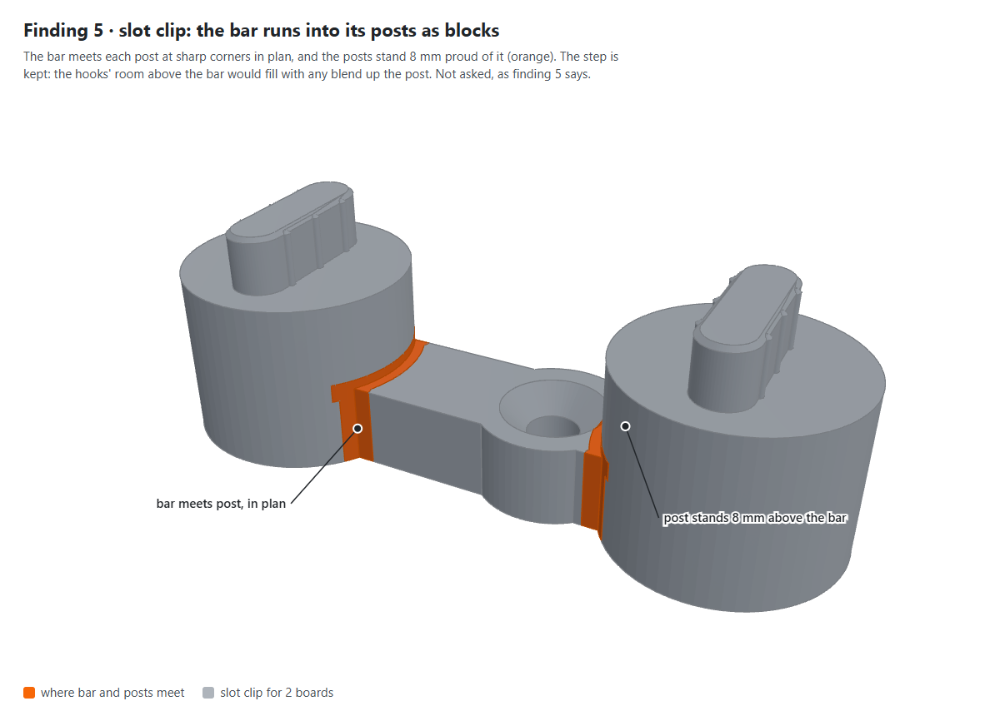
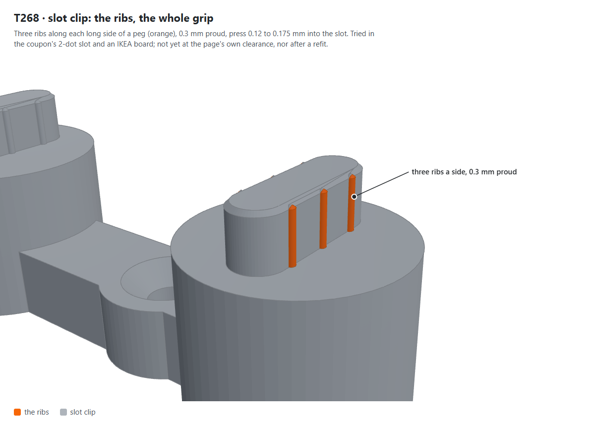

# The connectors, a design pass (19 Oct 2026)

A review of the two connectors, the standoff and the slot clip, against the owner's engineering practices as they
stood on 19 Oct 2026: `printed-part-design` (with its section on how a part looks, added that day) and
`printed-part-engineering`, both in `AlonRR/engineering-practices` (at its commit `b2d1c16`). Nothing was changed by
it; each change it recommends is a question in [`status.md`](../status.md) (D264 to D267, T268, A269).

The figures are renders of the library's own parts at `5d516cc`, the area of each finding in orange, made
with three.js from the meshes the page builds.

Tags: **(verified: code)** read from the source at `5d516cc`; **(computed)** arithmetic on verified numbers;
**(relayed)** from the owner's report; **(inferred)** reasoning; **(to confirm)** a bought part's size not measured.

## The parts, and what they face

| | Standoff | Slot clip |
|---|---|---|
| Job | holds 1, 2 or 4 boards' corners off the wall, the corner screw through board and standoff | joins boards behind a seam by a ribbed peg in each board's nearest slot; fixed by a screw, a keyhole or the wall |
| Printed | wall face down, holes upright (verified: code) | wall face down, pegs up (verified: code) |
| Seen | in the gap behind a board; at a wall's outer corner partly from the side | not at all, but for the pegs' ends, flush in their slots (D250 a) |
| Load | axial compression under the screw's clamp; the board's weight by friction and the screw in shear | the boards' shift across the seam, into the pegs; its own weight on the pegs |

Both stand behind the boards, so the practice's section on how a part looks, written for show parts, is applied
here in proportion: the standoff a little, the clip hardly at all.

## The numbers checked

- **Screw holes** (verified: code, `screwHole`): hole = screw + 0.5 mm, countersink = 2 × screw + 1 mm, a
  standoff's outside = hole + 5.5 mm. For a 4 mm screw: 4.5, 9 and 10 mm.
- **Standoff wall round the hole**: (10 − 4.5) / 2 = 2.75 mm (computed). For 4 boards, between a hole and the
  tunnel: the hole's edge at 10 − 2.25 = 7.75 mm from the middle, the tunnel's side at 5.6, so 2.15 mm
  (computed). The 2-board bridge is 2 × (10 − 5.6) = 8.8 mm wide, against posts of 10 (computed).
- **Clip bar**: the depth less the hooks' room, 8 mm (6 mm of hook and a 2 mm margin): 7 mm at the starting 15 mm
  (computed). Its screw sits 5 mm from the seam, its pad 13 mm across, 4.25 mm from the hole's edge to the pad's
  (verified: code; computed). The hooks' room along the seam is 11.2 mm wide, 5.6 mm each side (computed).
- **Peg fit** (computed from the drawn sizes; the printed rib is not measured): a peg is drawn 4.8 mm wide (the
  5.2 mm slot less 0.4), its ribs 0.3 mm proud each side, 5.4 mm across. Into a slot printed 5.16 mm wide, the
  page's starting clearance (D129, T109), that is 0.12 mm of rib per side; into the fit coupon's 2-dot slot,
  printed 5.08 mm (T109), 0.16; into an IKEA slot, 5.05 to 5.15 mm (D129), 0.125 to 0.175.
- **Slot chamfer at the board's back**: 1 mm at 45° (verified: code, D41), with 0.2 mm between a peg's side and
  the slot's straight wall each side (computed).

## Against `printed-part-design`'s review questions

| # | Question | Standoff | Slot clip |
|---|---|---|---|
| 1 | Bought or standard sizes measured or tagged | the slot and grid cited (`skadis-standard.md`); the screw's head is not asked for | as the standoff; the T193 fit is relayed |
| 1 | Placement seen in every axis | the tunnel cut along the seam's slot column (D97) | the posts sized to clear every other slot (C192), the hooks' room above the bar |
| 2 | Support, or anything cut off after | none | none; the keyhole's lips are a bridge from the bed, as the boards' are, which T151 is still to report on |
| 2 | Exported as it prints, projections up | yes | yes: the pegs on top |
| 3 | Each part justified, located before released | **the standoff floats behind the board while the first screw goes through (finding 4)** | located: pegged into the first board before anything else arrives (C199) |
| 3 | Wrong way round impossible | symmetric | symmetric but for the screw, which is turned to the free board; the hole shows which way |
| 3 | Air paths | none | none |
| 4 | Captive nuts, screw lengths from the stack, heads in a counterbore | **no screw length stated anywhere (finding 1)** | **its screw is countersunk (finding 2)**; no length stated (finding 1) |
| 5 | Tool reach, disassembly | the driver straight down the hole | the screw driven before the second board, as its help says |
| 6 | One part, chamfered, sections blended | **unchamfered; the tunnel and the 2-board bridge meet the posts at sharp corners (finding 5)** | **unchamfered; the peg meets its post at a sharp inside corner (finding 3)** |
| 6 | Flush | the board's countersunk head is the board's | the countersunk head sits flush in the bar; the pegs flush with the front (D250 a) |
| 6 | Marks and patterns | none needed | none needed |

## Against `printed-part-engineering`'s checklist

Rows that do not apply (seals, condensate, air paths, motion, heat) are left out: both parts live at room
temperature, behind a board, and do not move once mounted.

| # | Check (states) | Standoff | Slot clip |
|---|---|---|---|
| 1 | Each loose part stays put (O, A) | held by hand until the first screw is tight, then clamped | held by its ribs from the first board on, and by the slots' ends from falling |
| 4 | Constraint | clamped between board and wall; one datum | x by the ribs, y by the slots' ends with 0.2 mm play; the second board then set by the pegs, before its own screws |
| 5, 6 | Worst case, compliance against the stack (T) | n/a | **the ribs press 0.12 to 0.175 mm per side (computed), about the size of a printer's stack, where the rule wants three times it (finding 6)** |
| 7 | Quantisation | n/a | the 0.3 mm rib is one or two extrusions in plan, set by the slicer's width (inferred) |
| 9 | Print | no ceiling but the hole's, which is open | the keyhole's lips bridge the head's channel (T151) |
| 10 | After relaxation (R) | the clamp on the board's countersink, at room temperature | **crushed ribs relax: untested (finding 6)** |
| 16 | Fasteners: clamp carrier, edge distance max(d, 2t) | 2.75 mm round a 4.5 mm hole: under d, but the load is axial compression with the screw in shear, not tear-out toward an edge; widening it would take the room round the slots (D94, C83) | 4.25 mm round the hole, under d; the screw only holds the clip against the wall |
| 17 | Nuts | none | none |
| 18, 19 | Tool access, disassembly (S) | yes | **taking a clip out and refitting it crushes the ribs again: untested (finding 6)** |
| 22 | DFMEA | below | below |

**DFMEA, one line each** (stay, move, come apart):

- **Standoff**: fails to *stay* while the first screw is driven (finding 4); prevented by holding it, or a tight
  section of hole (D267). Could *come apart* by splitting round the hole only under a hard sideways blow; the wall
  is 2.75 mm (no change proposed).
- **Slot clip**: fails to *stay* if the ribs grip too little in a board at the wide end of its fit, or after a
  refit; checked by T268. Could *come apart* at the peg's root, a sharp corner on a layer line, if a board is
  levered across the seam; prevented by a root chamfer (D266).

## Findings, by weight

1. **No screw length is stated anywhere** (verified: help texts, `printables.md`, README). The practice: choose each
   screw's length from its stack and state the hardware list. The stacks are known exactly: a board on a standoff
   is 5 + the standoff's height in plastic, 20 mm at the start; a clip's screw passes 7 mm of bar at 15 mm deep.
   The wall plug is the user's. → **D264**.

   
2. **The clip's screw is countersunk**, where the practice says never countersink: the cone wedges its hole open.
   Weighed here (inferred): the hoop load runs round the hole, along the printed perimeters, the strong direction;
   it is a light clamp at room temperature, which the practice itself finds enough for a flat head; and most wall
   screws to hand are countersunk. A round (pan) head would need a counterbore, not a head standing on the bar: the
   screw sits 5 mm from the seam and its head would reach into the 5.6 mm of hooks' room along the seam. A pan head
   about 3 mm tall (to confirm) in a counterbore leaves about 3.7 mm of floor at the starting depth, and needs a
   clip about 13 mm deep or more. → **D265**.

   
3. **The peg meets its post at a sharp inside corner**, on a layer line, the place a peg would snap if a board is
   levered across the seam. The practice: radius the roots. A 0.8 mm chamfer round each peg's root fits inside the
   slot's 1 mm back chamfer and keeps the 0.2 mm the peg has beside the slot's wall (computed), so the fit T193
   tried is unchanged (inferred). → **D266**.

   
4. **The standoff is not located before it is released.** It is held behind the board by hand until the first
   screw is tight; after that the clamp holds it, and a shared one holds the next board's corner. A collar into
   the board's hole is not possible (a 4 mm screw in a 4.5 mm hole leaves a 0.1 mm wall). A short tight section of
   its hole, about 0.85 times the screw for 2 mm at the board face (the practice's self-tapping pilot), would let
   the screw, pushed through the board, carry the standoff to the wall; it needs a coupon, as printed pilots come
   out undersize. → **D267**.

   
5. **Neither part is chamfered**, and their sections meet at sharp corners: the tunnel's floor and walls, the
   2-board bridge into its posts, the clip's bar into its posts. In proportion: the clip is never seen, and the
   standoff only from the side. Two limits force steps here and keep them: the hooks' room above the clip's bar,
   which a blend up the post would fill, and the slot margin that narrowed the 2-board bridge (C100). The practice
   asks then for deliberate steps, one chamfer size across a family. The family that is seen is the boards, whose
   outer edges are not chamfered either; the look belongs to a pass on the boards, with the connectors following
   it, not to this one. No question asked.

   

   

   
6. **The ribs are tested in two slots, once, and new** (relayed: T193). The interference is about the size of a
   printer's worst-case stack, where the practice wants a working deflection three times it; it held in the coupon's
   2-dot slot and an IKEA board. Untested: a slot at the page's own starting clearance, the wide end (the coupon's
   3-dot slot, printed 5.16 mm), and a clip pulled out and pushed back in, as crushed ribs do not spring back. →
   **T268**. Relaxation over weeks is the same question over time, and is left to the first walls hung.

   
7. **The repository's `CLAUDE.md` says five connector types**; there are two. → **A269**. A text fix: no part to
   show.

## Not findings

- The 2.75 mm wall of the standoff is under the edge-distance rule, but the rule is for a screw pulled toward an
  edge; this one is clamped along its axis, and the wall is fixed by the room the slots need (D94, C83).
- The clip turned the wrong way puts its screw under the board already up. The hole is in sight while the clip is
  pegged, and the help text says which side; a mark would add little.
- The clip's keyhole shares the boards' construction; T151 answers for both.
