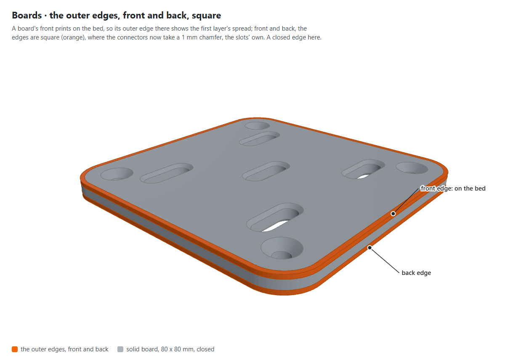
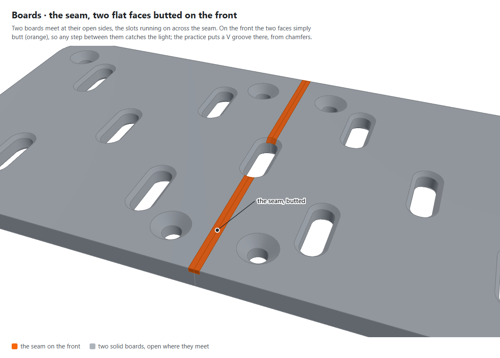
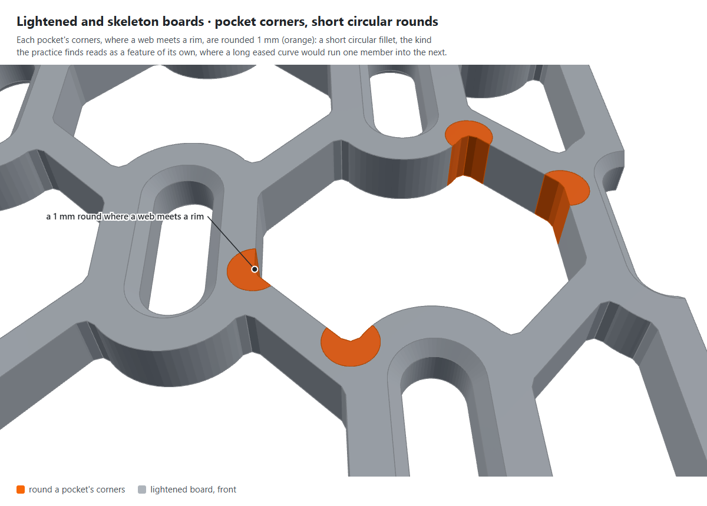
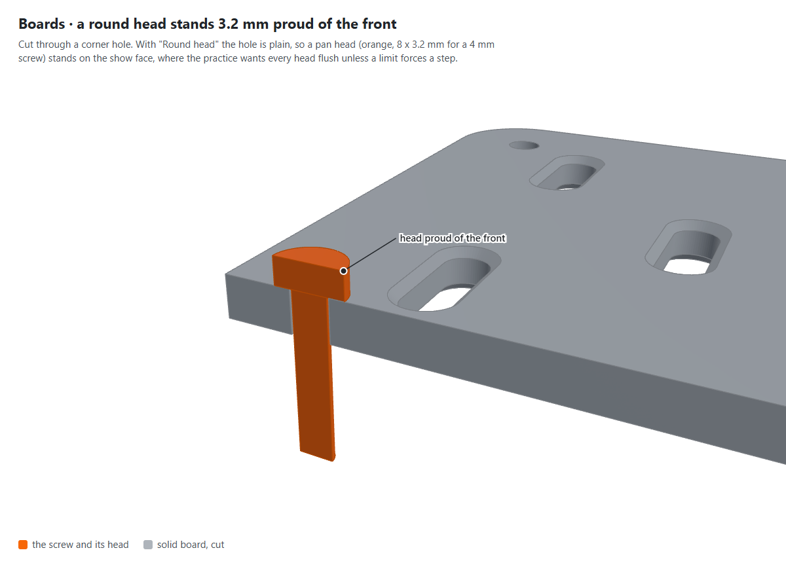
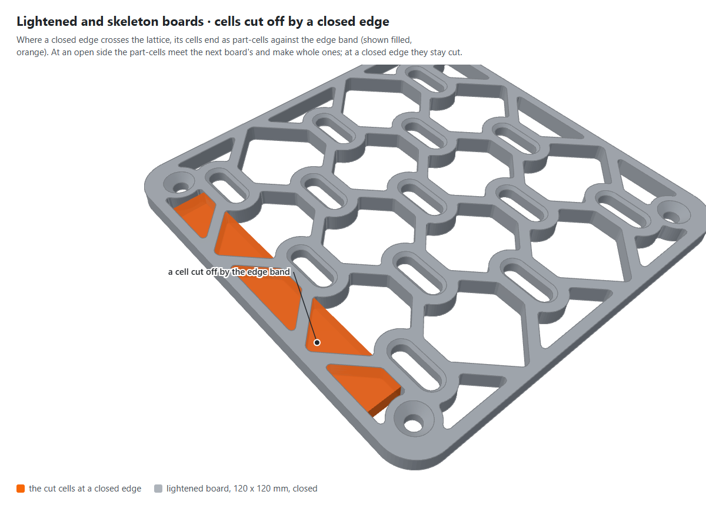
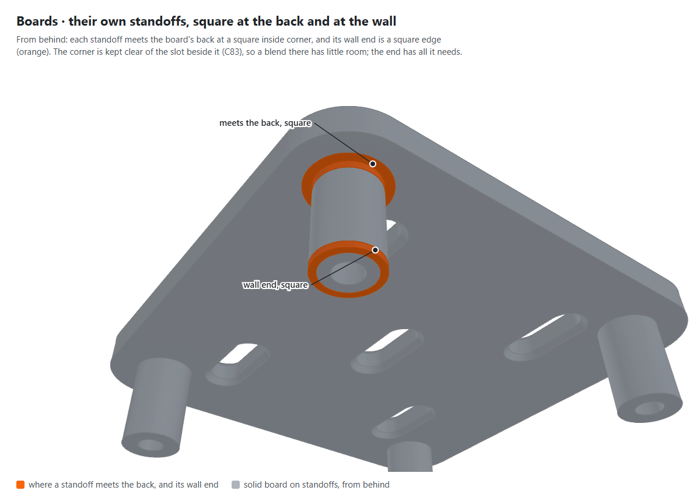

# The boards, a design pass (21 Oct 2026)

A review of the boards, solid, lightened and skeleton, their own standoffs and screw holes, against the owner's
engineering practices of 19 Oct 2026: `printed-part-design`, with its section on how a part looks, and
`printed-part-engineering` (`AlonRR/engineering-practices` at `b2d1c16`), as the connectors' pass of 19 Oct
([`2026-10-19-connectors-design-pass.md`](2026-10-19-connectors-design-pass.md)) was. Nothing was changed by it; each
change it recommends is a question in [`status.md`](../status.md) (D276 to D279).

The figures are renders of the library's own boards at `cba3a56`, the area of each finding in orange, made by
`scripts/figures/shoot.mjs boards-pass`. Tags: **(verified: code)** read from the source; **(verified: sliced)**
from PrusaSlicer's G-code of the Printables files on 21 Oct 2026, the STL check's profile (0.4 mm nozzle, 0.2 mm
layers, 0.45 mm lines, two perimeters); **(computed)** arithmetic on verified numbers; **(inferred)** reasoning.

## The parts, and what they face

| | Solid | Lightened | Skeleton |
|---|---|---|---|
| Body | a 5 mm plate, the slots chamfered 1 mm at both faces (D41) | the plate, pockets cut through between rims round the slots and webs along the grid's diagonals (D141 to D144) | the lightened lattice, every member an I-beam to a 1.2 mm core (D146, D147) |
| Edges | open sides cut through a slot column, to tile (D15); closed sides solid, closed corners rounded 10 mm (D39) | the same, a 3 mm band along every edge | the same |
| Printed | face down: the front, the show face, on the bed (D66) | the same | the same, no face past 45 degrees |
| Seen | its front, and its edges from the side | its front lattice | its front lattice |
| Load | hooks bear on the slots' walls in the board's plane, along the layers; the corner screws clamp it to the wall or its standoffs | the same, through the rims and webs | the same |

A board alone starts with every side open (verified: code), so its whole outline is a seam edge until a wall closes
its outer edges (D37). The boards are the show parts of the family, so the practice's section on how a part looks
applies to them in full.

## The numbers checked

- **Thickness** 5 mm, 25 layers of 0.2 mm (computed). **Corner radius** 10 mm where both sides are closed, still
  `<<CONFIRM>>` as IKEA's (D39). **Edge band, rims and webs** 3 mm; **pocket corners** rounded 1 mm; the skeleton's
  core 1.2 mm, its flanges 0.6 mm deep (verified: code).
- **Sliced**, the 240 x 200 mm boards: perimeters and infill only, **no gap fill** in any of the three (verified:
  sliced). Corrected the same day: the profile's perimeter generator is Arachne, which varies its lines' widths to
  fill a member and never writes gap fill, so this could not have found any; it says nothing of whole lines. About 8 h 16 min and 66 g for the lightened
  board, 8 h 57 min and 67 g the skeleton, 8 h 53 min and 115 g the solid (ASA at the check's profile).
- **Corner screw holes** 10 mm in from both edges, 4.5 mm across for a 4 mm screw, countersunk 90 degrees to 9 mm,
  2.25 mm deep, leaving 2.75 mm of plain hole (verified: code). The edge rule, at least max(d, 2t) = max(4.5, 10) =
  10 mm: the hole's centre is 10 mm from each edge, at the limit; its edge 7.75 mm (computed).
- **A round head**, taken as D157's pan head, 8 x 3.2 mm for a 4 mm screw, stands 3.2 mm proud of the front; sunk
  in a counterbore as the clip's (C271), 8.5 mm across and 3.4 mm deep, it would leave 1.6 mm of board under it,
  eight layers, with the standoff behind it where the board has one (computed).
- **The cut cells**: on a 240 x 200 mm board closed all round, 40 of the lightened board's 71 pockets are cut by its
  edge band, 12 640 mm2 of them; filled solid they would add 63 cm3, 76 % more plastic. The skeleton's 32 of 63,
  77 cm3 filled, 122 % more (computed, from the board's section).

## Against `printed-part-design`'s review questions

| # | Question | Solid | Lightened, skeleton |
|---|---|---|---|
| 1 | Standard sizes measured or tagged | the slot and grid cited, measured against IKEA's (T17, D129); the corner radius `<<CONFIRM>>` | the same |
| 1 | Placement in every axis | the slots and their chamfers in section (D41) | the I-beam's taper in section (D147) |
| 2 | Support, or anything cut off after | none; the countersink a 45 degree overhang at the bed (verified: code) | the same; the skeleton's tapers at 45 degrees |
| 2 | Exported as it prints | face down, the standoffs printing upward | the same |
| 3 | Parts justified, located before released | a wall's panels are each a bed's size, joined by clips and standoffs | the same |
| 4 | Screw heads in a counterbore, not countersunk | **countersunk at the start (the connectors' finding 2 again); a round head stands proud (finding 4)** | the same |
| 5 | Tool reach | the driver straight at the front | the same |
| 6 | One part, chamfered, blended | **outer edges square, front and back (finding 1)** | **the same; the pockets' corners short circular rounds (finding 3)** |
| 6 | Flush | the countersunk head flush; **a round head proud (finding 4)** | the same |
| 6 | Joints on a show face a V groove | **the seam butts flat (finding 2)** | the same |
| 6 | Marks | the fit coupon's dots, counted, off the working faces (D67) | none |
| 6 | Patterns drawn, whole cells, centred, not squares | n/a | drawn in the model, diamonds and octagons, not squares; **cut at a closed edge (finding 5)** |

## Against `printed-part-engineering`'s checklist

Seals, condensate, air paths, motion and heat do not apply: the boards hang still at room temperature.

| # | Check (states) | The boards |
|---|---|---|
| 1 | Each loose part stays put (O, A) | a board hangs on its screws; on keyholes, on its keyhole lips (T151 asks whether they hold) |
| 4 | Load along the layers | hooks bear on the slots' walls in the board's plane, along the layers (inferred) |
| 7 | Quantisation | 5 mm in 25 layers; no gap fill in the members (verified: sliced) |
| 9 | Print | the keyholes' lips bridge the head's channel (T151) |
| 16 | Fasteners: clamp carrier, edge distance | countersunk heads in 5 mm of plastic, the hoop load along the perimeters (the connectors' finding 2); the corner hole's centre at the edge rule's 10 mm (above) |
| 22 | DFMEA | below |

**DFMEA, one line each**: a board fails to *stay* if a keyhole's lips do not hold (T151); could *come apart* round a
corner hole under a blow, the hole at the edge rule's limit; a standoff on its back could snap at its square root if
the board is levered off the wall (finding 6).

## Findings, by weight

1. **The outer edges are square, front and back**, and the front's is the bed edge: the first layer's spread shows
   there on the show face, which a chamfer would hide, and the connectors now take a 1 mm one (D270). The boards' own
   standoffs end square at the wall too. → **D276**.

   

2. **The seam butts flat on the front.** Two boards meet at their open sides, the slots running on across it, and
   any step between their faces catches the light; the practice makes a show face's joint a V groove from matching
   chamfers, so the joint is a line meant to be there. A board alone, all its sides open, would take that chamfer
   round its whole outline. → **D277**.

   

3. **The pockets' corners are short circular rounds**, 1 mm where a web meets a rim, which the practice finds read as
   a feature of their own, where a long eased curve runs one member into the next, as the connectors' blends now do.
   On the skeleton the curve would follow its taper through the board. → **D278**.

   

4. **A round head stands 3.2 mm proud of the front**, where the practice wants every head flush. Sunk as the clip's
   is, it would leave 1.6 mm of board under it, backed by a standoff where there is one. → **D279**.

   

5. **A closed edge cuts the lattice's cells**, where the practice wants whole cells only. Here the cells are the slot
   grid's own, which an open side halves and the next board completes, and filling those a closed edge cuts would add
   76 % to the lightened board's plastic and 122 % to the skeleton's. Recommended: keep them. No question asked.

   

6. **The boards' own standoffs meet the back at a square inside corner.** A blend there would stand in the 2 mm the
   standoff keeps clear of every slot's chamfer edge (C83), and behind the keyhole standoffs in the hook's room cut
   for them (D244), so the step stays, as the clip's posts do (C275); their wall ends take D276's chamfer. No
   question asked.

   

## Not findings

- **The countersink** goes against the practice's rule, but as on the clip (D265) its hoop load runs along the
  perimeters, the clamp is light and at room temperature, and wall screws are mostly countersunk; a round head is
  offered, and D279 asks to sink it.
- **The corner hole's edge distance** is at the rule's limit from its centre; the board is clamped flat, not pulled
  toward its edge.
- **No gap fill** in any member (verified: sliced), so the widths need no change for the slicer. Corrected: under
  Arachne no slice has gap fill (above); the members print as perimeters and infill.
- **Warping**: a closed corner is rounded 10 mm, the practice's plan-view radius; an open corner stays square to tile.
- **The keyholes' lips** are T151's to answer.
