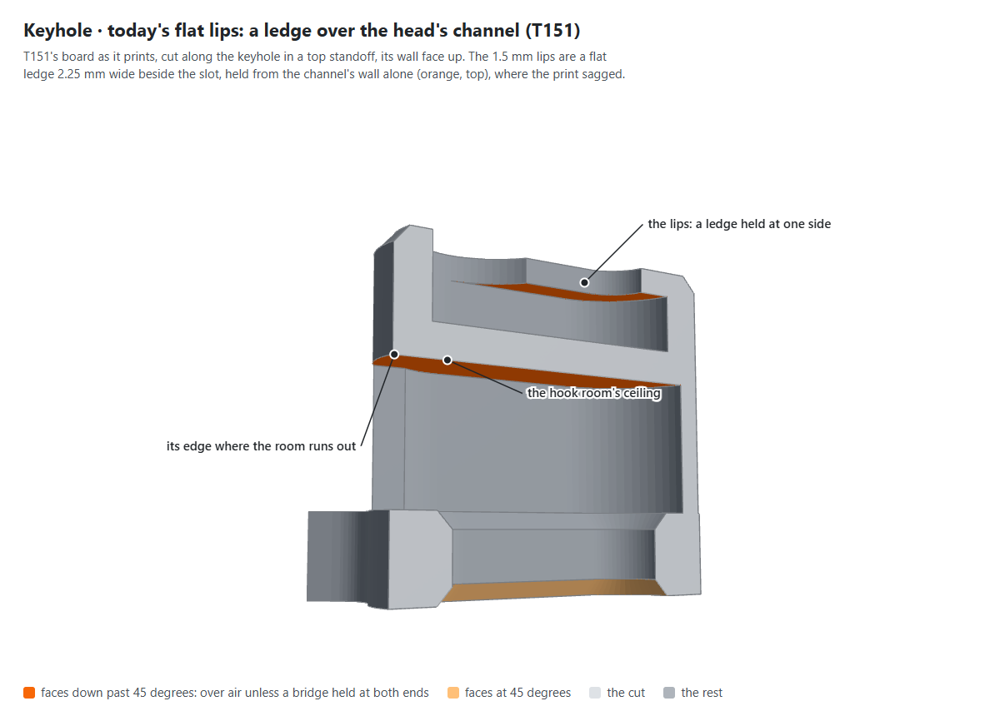
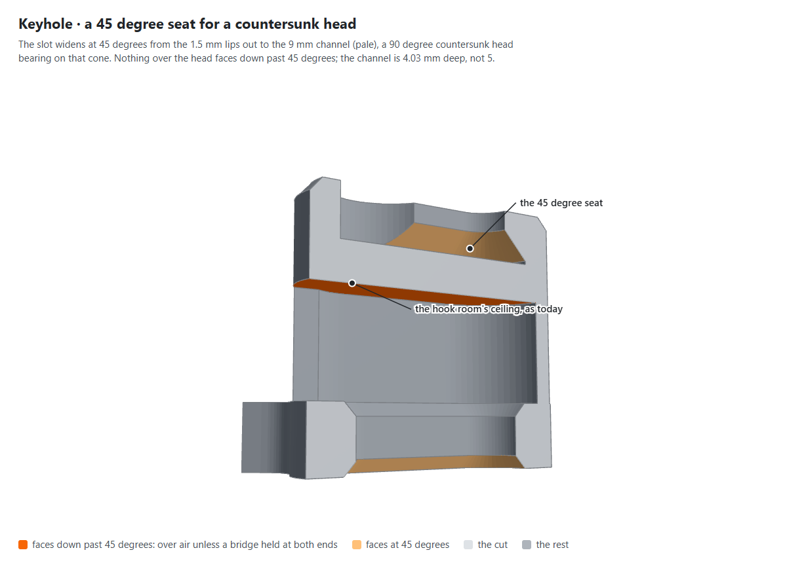
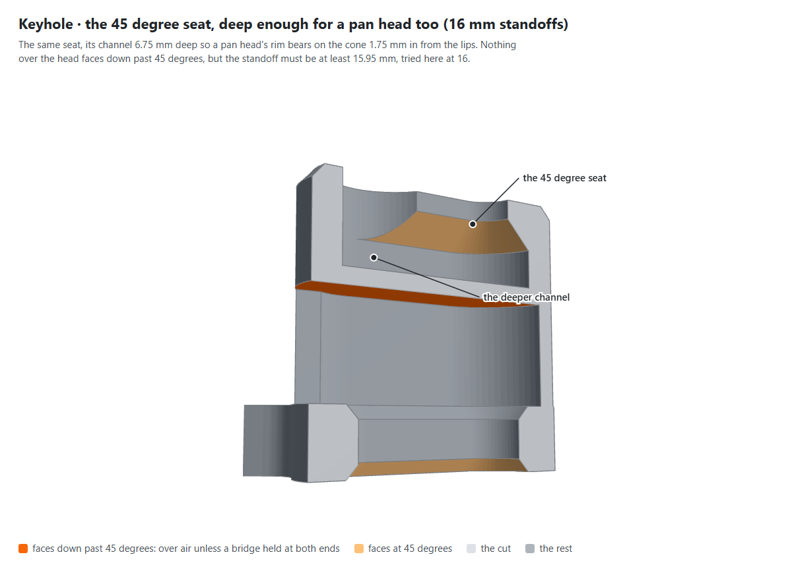
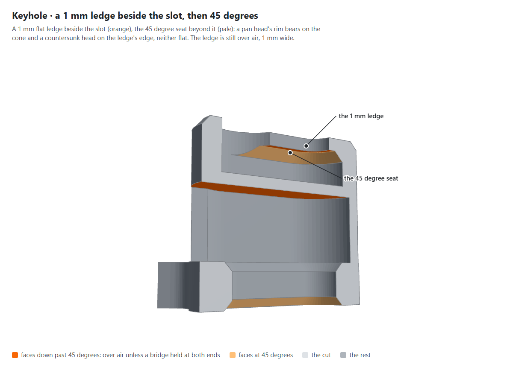
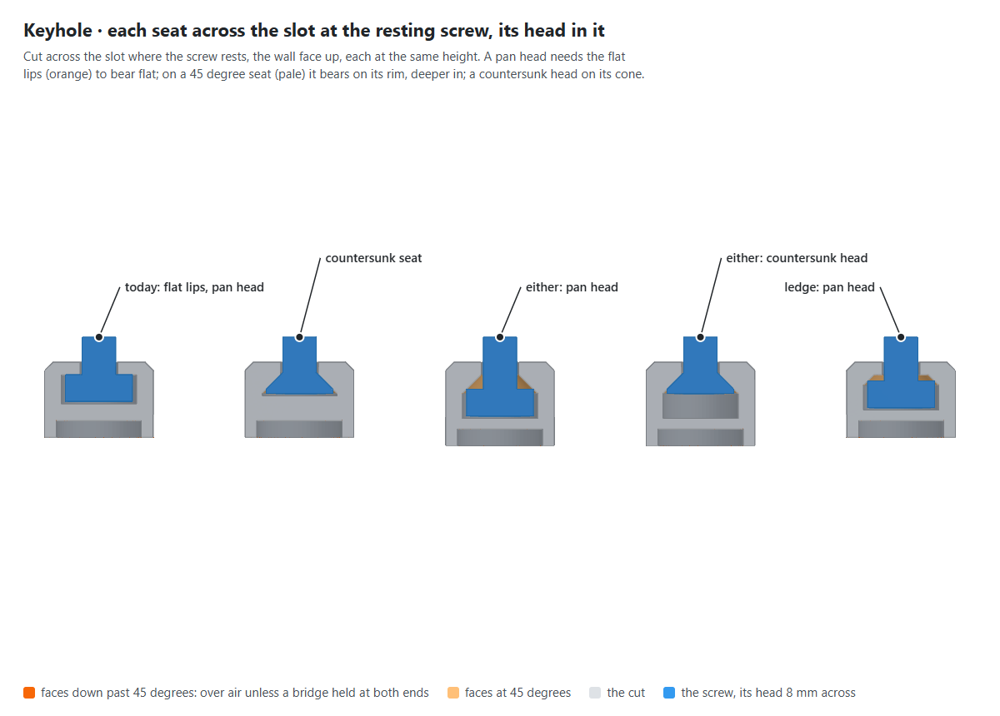
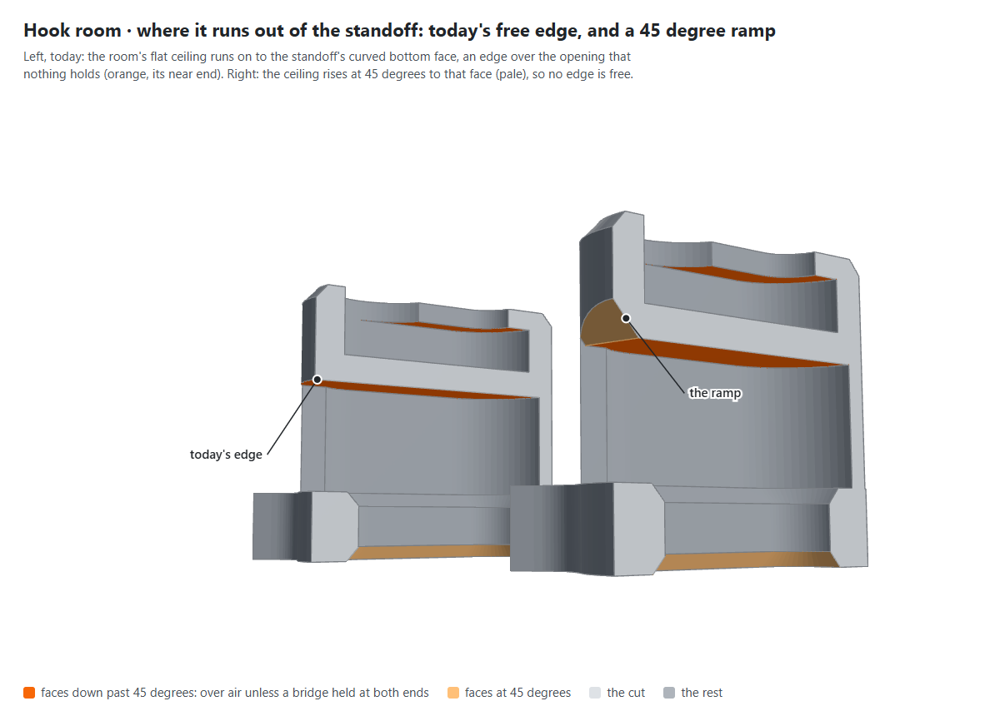
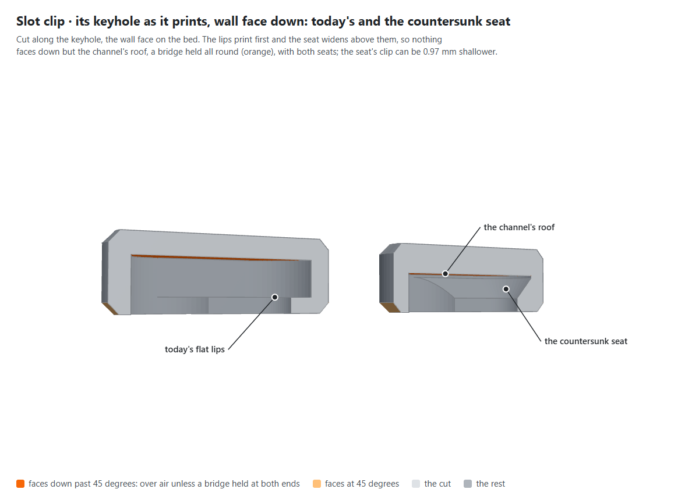

# The keyhole and the hook's room, a printability pass (23 Oct 2026)

The owner printed T151's board, the 80 x 80 mm lightened board on keyholes and 15 mm standoffs, in PETG, and found
"some sag in the keyhole and at the back where the hook cutout is. We need to fix the printability of the keyhole and
hook cutout" (relayed, with two photos, 23 Oct 2026). This pass measures both, tries options for each and recommends
one, against `printed-part-design`'s section on geometry that prints as drawn: no support and nothing sacrificial, and
every overhang 45 degrees or less, or a bridge held at both ends.

**Built 23 Oct 2026** (D358 a, D369 a; C381 to C386): the owner chose K1, the countersunk seat, and R1, the ramp,
which every keyhole and hook room now are, on every board and in the slot clip. The prototypes' switches went with
it, so what follows, up to [As built](#as-built-23-oct-2026), is the pass's record as it ran on
`feat/keyhole-printability`: its figures were drawn by `scripts/figures/keyhole-pass.mjs` and its options written by
`scripts/checks/write-keyhole-options.mjs`, both retired or rewritten with the switches (C385).

Nothing on `main` changed. The options are prototypes on the branch `feat/keyhole-printability`, off unless asked for
(C361): `keyholeSeat` and `roomExit` in the mounting, `keyholeSeat` in the slot clip. Each is measured as T151 printed
it, written by `scripts/checks/write-keyhole-options.mjs` and sliced once through `scripts/checks/stl-check.sh` with
PETG Basic, the loaded filament (C367); `scripts/checks/overhang-report.py` sums what each slice prints as overhang
perimeter and bridge infill per layer, and what lies under it (C360). The figures are renders of the library's own
parts by `scripts/figures/shoot.mjs keyhole-pass`, as they print, every face that faces down past 45 degrees in orange.

Tags: **(verified: code)** read from the source or measured on the library's solid by its tests; **(verified:
sliced)** from PrusaSlicer's G-code, the STL check's profile (`0.2mm QUALITY @MK3 - no skirt, no brim, no crossing
perimeter`: 0.2 mm layers, 0.45 mm lines, two perimeters, Arachne, thick bridges), filament `PETG Basic
NPETG087-ZX`; **(computed)** arithmetic on verified numbers, or the area of the solid's faces; **(inferred)**
reasoning; **(relayed)** the owner's words.

## The geometry, as T151 printed it

For a 4 mm screw (verified: code, `packages/core/src/mounting.ts`). The board prints face down, its front on the bed
from z 0 to 5, and each standoff rises to its wall face at z 20.

- **The keyhole**, in the top two standoffs' wall faces: a 4.5 mm slot and a 9 mm entry through 1.5 mm of lips (z 18.5
  to 20); behind them the head's channel, a 9 mm stadium 18 mm long and 3.5 mm deep (z 15 to 18.5), the pan head's
  3.2 mm and 0.3 spare; then 2 mm of standoff, of which 1.2 is the least (`MIN_BEHIND_CHANNEL_MM`). Printed, **the lips
  are a flat ledge 2.25 mm wide beside the slot, held from the channel's wall alone**: its edge at the slot is in air.
- **The hook's room**, behind the slot each standoff stands behind, z 5 to 13: the slot and its chamfer grown 2.5 mm,
  and the hook's back tab, 8.5 mm wide, reaching 10.25 mm below the slot's bottom end. The lattice board's standoff is
  the frame's outline, 13 x 23 mm (D306), and ends 3.9 mm below the slot's bottom (4.4 on the solid board's 15 x 24),
  so **the tab runs 6.35 mm out of the standoff's curved bottom face, and the room's flat ceiling at z 13 ends there in
  an edge over the opening**, curved as that face is, with the standoff's 7 mm of wall above it. All four standoffs
  have it (D245).
- The caller's reading of these numbers checks out against the code, the tab's 10.25 mm included.

(verified: code: the library's own part at this branch's tip, as it prints; the orange and pale faces computed from its mesh)

## The baseline, in PETG

T151's file, `.check/test-print/skadis-trial-keyhole.stl`, written again from this branch is the same past its 80-byte
header (verified: code, `cmp`). Sliced in PETG (verified: sliced):

| z | Overhang perimeter | Bridge infill | Of the bridge, over air | What it is |
|---|---|---|---|---|
| 4.2 | 0 | 3182.8 mm | 0.0 mm | internal bridge: the plate's first top layer over its infill |
| **13.2** | **70.8 mm** | **1952.2 mm** | 663.4 mm | **the rooms' ceilings, four standoffs** |
| 14.2 | 0 | 909.9 mm | 9.4 mm | internal bridge under the channels' floors |
| **18.8** | **92.1 mm** | **333.2 mm** | 0.0 mm, as the 2.25 mm ledge is narrower than the 3 mm the report looks across: all of it is over air | **the lips, two keyholes** |
| 19.2 | 0 | 942.5 mm | 0.0 mm | internal bridge under the wall faces |

They are the caller's ASA slice of 22 Oct to the tenth (relayed): what is an overhang is geometry, not the filament.

- **The bridges at z 4.2, 14.2 and 19.2 are PrusaSlicer's internal bridges**, as the caller thought (verified:
  sliced): 0.0, 1.0 and 0.0 % of them lie more than 3 mm from the layer below's extrusions, and those are 74 to 80 %
  sparse infill at 14.2 and 19.2, sparse or solid infill at 4.2; each is the first of the five top layers, 1 mm under
  a top face (the plate's back, the channels' floors, the wall faces). At z 13.2 a third of the bridge is over air:
  a true bridge, across the rooms.
- **Where the overhang perimeters are** (verified: sliced): at z 13.2, eight paths, the two perimeters at each of the
  four rooms' exits, each 8.6 to 8.8 mm long on a chord of 7.8 to 8.1 mm: arcs, as the standoff's face is. At z 18.8,
  four paths of 22.7 to 23.4 mm, the two perimeters round each slot's top end: the ledge's free edge.
- **Faces past 45 degrees** (computed, on the library's solid): 103.8 mm2 over the heads, the two ledges; 58.7 mm2 of
  the rooms' ceilings beyond where a ramp would start (below).

## Does the sag matter?

- **The keyhole's, yes (inferred).** The channel leaves 0.3 mm past a pan head; strands hanging further into it block
  the head as it slides behind the lips, or are pushed off by it, and the lips' face, which the head bears on, is the
  sagged one. The owner's hanging step of T151 is still to say whether the heads went in.
- **The room's, probably not (inferred).** The sagging edge is the room's ceiling, 8 mm behind the board, where the
  hook's back tab takes 6 mm (C99's 2 mm margin); a sag under 2 mm still lets the hook in, and that ceiling carries no
  load. It cannot be seen from the front. How we would know: T151's hanging puts an IKEA hook in each corner slot,
  under those edges; if each goes in and sits straight, the sag does not matter. Fixing it is still the rule's: the
  edge is curved and held by nothing between its ends, and the standoff's wall is built on it.

## The keyhole's options

The head bears on the lips' inner face, which prints facing down. A pan head's flat underside covers the slot's edge
out to 4 mm from the screw's axis, so the face under it must be flat out to there, at least 1.75 mm beside a 4.5 mm
slot (computed): **a pan head cannot bear flat on a ledge of 1 mm or less**, the brief's idea (b); with one, its rim
bears on the cone beyond. The only geometry that leaves no flat face over the head is a seat that narrows at 45
degrees to the slot, and a head shaped to it: a 90 degree countersunk head.

| | Seat | Heads it takes, and where they bear | Channel deep | Head's top out of the wall | Least standoff |
|---|---|---|---|---|---|
| K0 | today: flat 1.5 mm lips | pan, flat on the 2.25 mm ledge | 5.0 mm | pan 4.7 to 5.0 mm | 14.2 mm |
| K1 | **countersunk**: 45 degrees from the slot to the channel | countersunk, on its cone | 4.03 mm | countersunk 3.73 to 4.03 mm | **13.23 mm** |
| K2 | **either**: K1's seat, deeper | pan on its rim, 1.75 mm in; countersunk on its cone | 6.75 mm | pan 6.45 to 6.75; countersunk 3.73 to 4.03 | **15.95 mm**, over the 15 mm start (D238) |
| K3 | **ledge**: 1 mm flat beside the slot, then 45 degrees | pan on its rim, 0.75 mm in; countersunk on the ledge's edge | 5.75 mm | pan 5.45 to 5.75; countersunk 3.73 to 4.03 | 14.95 mm |

Sizes for a 4 mm screw (verified: code, `keyholeSeat`, and its test); a pan head D157's 8 x 3.2 mm, a countersunk
head DIN 7991's 8 x 2.48 mm (C362, `<<CONFIRM>>` against the screws the owner would use); the range is the seated head
and the 0.3 mm spare. Every seat keeps the 1.5 mm of lips at the slot's edge (C364). For a 5 mm screw the least
standoffs are 15.0 today, 13.85 for K1 and 17.25 for K2 (computed).

(verified: code: the library's own part at this branch's tip, as it prints; the orange and pale faces computed from its mesh)

(verified: code: the library's own part at this branch's tip, as it prints; the orange and pale faces computed from its mesh)

(verified: code: the library's own part at this branch's tip, as it prints; the orange and pale faces computed from its mesh)

(verified: code: the library's own part at this branch's tip, as it prints; the orange and pale faces computed from its mesh)

**Considered, not built.** A two-bridge ceiling, the practice's own answer for a counterbore printed face down, needs
every first-layer bridge line held at both ends: beside the slot the lines would run along it, and the entry, as wide
as the channel, ends each of them in air (inferred). Thicker lips or a deeper channel keep the ledge over air. Printing the board
another way round is D66's, and its front is the show face.

## The hook room's options

| | Exit | What prints |
|---|---|---|
| R0 | today: the flat ceiling runs on to the standoff's face | an edge over the opening, curved, the 7 mm of wall above it built straight up on it |
| R1 | **ramp**: under the ceiling over the back tab, a 45 degree wedge from 0.5 mm short of the keyhole's channel down to the tab's end (C365) | the ceiling's first layer ends on a straight line across the tab, held at both ends by its walls; each layer above steps 0.2 mm out, 45 degrees, to the standoff's face |

The ramp keeps 1.2 mm between the room and the channel at the least standoff of every seat (verified: code, `minGap`,
with a control 0.5 mm shorter that fails), takes nothing from the hook's 8 mm behind any slot (verified: code), and
takes about 10 mm3 from each standoff (computed: 41.7 mm3 from the four). It is the same on all four standoffs and on
the solid board (verified: code).

(verified: code: the library's own part at this branch's tip, as it prints; the orange and pale faces computed from its mesh)

**What the slice shows** (verified: sliced): the ramp's first layer still ends over the room, so PrusaSlicer still
prints its edge as overhang perimeter, 64.8 mm against 70.8; but as eight straight lines, each 8.1 mm long on an 8.1 mm
chord, held at both ends, which is a bridge line, where today's are arcs with the wall built on them. A ceiling that
opens to the side always has such a first edge somewhere unless the room is closed (inferred); nothing else at the exits faces
down past 45 degrees (computed: 0.0 mm2 against 58.7).

**Considered, not built.** Enclosing the room in a longer standoff, so its ceiling is a bridge held all round: the
standoff would reach 11.45 mm below the slot, 7.55 mm further, and the bottom ones would end 0.95 mm from the board's
bottom edge, inside its 1 mm chamfer, with the lattice frame grown over the pocket below each corner slot (C366,
computed). A notch through to the wall face, a gable or a hipped roof over the tab: the same first edge, and a wall
built on it or more taken out (C365).

## The options measured

T151's board, sliced in PETG (verified: sliced); faces past 45 degrees on the solid (computed); the STL check, each
file (verified: sliced: manifold, one part, one closed body, a slice with no skirt, brim or vase).

| Option | Lips: overhang perimeter / bridge | Rooms' ceilings, z 13.2: overhang perimeter / bridge | Past 45 degrees: over the heads / at the exits | Plastic | STL check |
|---|---|---|---|---|---|
| K0 R0, today (T151) | z 18.8: **92.1 / 333.2 mm** | **70.8 / 1952.2 mm**, arcs | 103.8 / 58.7 mm2 | 20.12 g | PASS |
| K1 countersunk | **none / none** | 70.8 / 1952.2 mm | **0.0** / 58.7 mm2 | 20.10 g | PASS |
| K2 either, 16 mm standoffs | none / none | 70.8 / 1952.2 mm | 0.0 / 58.7 mm2 | 20.39 g | PASS |
| K3 ledge | z 18.8: 76.2 / 142.7 mm | 70.8 / 1952.2 mm | 39.1 / 58.7 mm2 | 19.90 g | PASS |
| R1 ramp, today's lips | z 18.8: 92.0 / 333.2 mm | 64.8 / 1858.3 mm, **straight, held at both ends** | 103.8 / **0.0** mm2 | 20.08 g | PASS |
| **K1 R1**, countersunk and ramp | **none / none** | 64.8 / 1858.3 mm, straight | **0.0 / 0.0** mm2 | 20.07 g | PASS |

The other layers' bridges are the internal ones above, moved with the channel's floor (z 15.2 for K1, 20.2 for K2's
taller standoff); every one is 0 to 1.3 % over air. Printing times are 1 h 55 min to 1 h 58 min, as today's 1 h 56 min.

## The slot clip

The clip shares the keyhole's cutter (C199) and prints wall face down, so its lips are on the bed and a seat widens
above them: nothing in it faces down but the channel's roof, a bridge held all round, with every seat (verified: code,
its test; verified: sliced).

| Clip for 2 boards, a keyhole | Least depth | Overhang perimeter | The roof's bridge | Plastic | STL check |
|---|---|---|---|---|---|
| today, flat | 14.2 mm | none | z 5.2: 449.7 mm | 6.74 g | PASS |
| countersunk | 13.23 mm | none | z 4.2: 449.6 mm | 6.73 g | PASS |
| either, 16 mm deep | 15.95 mm | none | z 7.0: 455.7 mm | 7.00 g | PASS |
| ledge | 14.95 mm | none | z 6.0: 455.7 mm | 6.63 g | PASS |

(verified: code: the library's own part at this branch's tip, as it prints; the orange and pale faces computed from its mesh)

## Recommendations

- **The keyhole: K1, the countersunk seat.** It is the only seat with nothing over the head past 45 degrees at the
  starting 15 mm standoff: none sliced, none on the solid. The cone seats the head and centres the board on it, and the
  board's weight on the cone draws its top to the wall (inferred); the lips are 1.5 mm at the slot, as today, and
  thicker beyond it. The channel is 0.97 mm shallower, so the least standoff, and the clip's least depth, fall to
  13.23 mm. The cost is the user's: countersunk screws, not pan heads, their heads set 3.73 to 4.03 mm out of the wall
  rather than 4.7 to 5.0, which the page's help and screw note would say. K2 keeps pan heads too, with the same print,
  but needs standoffs of 16 mm where the family starts at 15 (D238). K3 does not fix the print: its 1 mm ledge still
  slices as 76 mm of overhang perimeter. One seat for the boards and the clip, so one screw holds a whole wall.
- **The hook's room: R1, the ramp**, whatever the keyhole: the exit's curved free edge becomes a straight first line
  held at both ends, and nothing else there faces down past 45 degrees; it costs nothing a user meets, a 45 degree face
  inside the standoff's bottom, behind the board. The sag it fixes probably does not matter to the hook (above), which
  T151's hanging can confirm.
- **Not in T151's print, the same kind of ledge**: with lock screws (A248), each bottom standoff's recess for the lock
  screw's head is a ceiling round the shank's hole, 31.6 mm2 past 45 degrees on the two (computed). A countersunk lock
  screw in a 45 degree seat, or a two-bridge ceiling there (a round recess, which it suits), would fix it.

## Questions for the owner

- **Which keyhole seat**: the countersunk seat (recommended), the deeper seat that takes either head at 16 mm
  standoffs, or today's flat lips. It decides the screw a user buys and how far its head stands out.
- **The countersunk screw**: are 4 mm countersunk wood screws with a 90 degree head what you would put in the wall?
  The seat is drawn for DIN 7991's 8 mm head, 2.48 mm tall; the head of the screw you would use, measured, settles it.
- **The ramp**: take it, a 45 degree face where each room runs out of its standoff, on the board's back?
- **Does the room's sag matter**: on the printed board, does an IKEA hook go into each corner slot and sit straight?
- **The slot clip**: give its keyhole the same seat, so one screw type holds every keyhole on a wall?
- **Lock screws**: treat their recess's ceiling the same way, as a follow-up?
- **A new test print**: once the seat is chosen, print T151's board again with it and the ramp?

## Not findings

- **A countersunk head's wedge.** The practice keeps countersunk heads out of clamped joints, which they wedge open;
  this head is not tightened, so the cone carries the board's weight and the hooks' pull, at room temperature
  (inferred).
- **The roof under the channel** stays 2 mm at 15 mm standoffs with every seat, 1.2 mm at each seat's least (verified:
  code).
- **Arachne and gap fill**: as the boards' pass found, the profile writes no gap fill; the overhang perimeters here
  are Arachne's perimeters over air.

## As built (23 Oct 2026)

D358 a and D369 a are built (C381 to C386): K1's seat and R1's ramp, with nothing left to switch. Measured again on the
parts as built, which `scripts/checks/write-keyhole-parts.mjs` writes through the page's own build:

- **T151's file**, `.check/test-print/skadis-trial-keyhole.stl` (`node scripts/test-print/write-trial-plate.mjs
  keyhole`), is the same past its 80-byte header as that script's `t151-board.stl` (verified: code, `cmp -i 80`). The
  STL check passes it with its own filament, ASA: manifold, one part, one closed body, 1 h 56 min, 16.60 g (verified:
  sliced).
- **Sliced in PETG** (verified: sliced; `FILAMENT="PETG Basic NPETG087-ZX" bash scripts/checks/stl-check.sh`, then
  `overhang-report.py`), 20.07 g and 1 h 56 min, it is K1 R1's row above to the tenth:

| z | Overhang perimeter | Bridge infill | Of the bridge, over air | What it is |
|---|---|---|---|---|
| 4.2 | 0 | 3182.8 mm | 0.0 mm | internal bridge: the plate's first top layer over its infill |
| 13.2 | 64.8 mm, 25.5 of it over air | 1858.3 mm | 618.1 mm | the rooms' ceilings, four standoffs |
| 15.2 | 0 | 909.4 mm | 0.0 mm | internal bridge under the channels' floors, 1 mm higher than before as the channel is shallower |
| 19.2 | 0 | 945.5 mm | 0.0 mm | internal bridge under the wall faces |

- **Nothing prints at the lips**, where today's printed 92.1 mm of overhang perimeter and 333.2 mm of bridge at z 18.8.
- **The rooms' first edges are eight straight lines**, each 8.10 mm long on an 8.10 mm chord, two at each of the four
  standoffs (verified: sliced, the overhang perimeter's paths at z 13.2), held at both ends by the tab's walls.
- **The slot clip for 2 boards with a keyhole**, 15 mm deep (`slot-clip-2-keyhole.stl`): no overhang perimeter; its
  channel's roof a bridge held all round, at z 4.2, 449.6 mm, 89.6 of it over air; 6.73 g, 36 min; PASS (verified:
  sliced). Its least depth is 13.23 mm, as the boards' least standoff.
- **On the solid** (verified: code, `packages/core/test/keyhole-seat.test.ts`, each against a control that rebuilds
  today's lips or ceiling from the built part, C382): nothing over the heads past 45 degrees and nothing where the rooms
  run out of their standoffs, on the solid, lightened and skeleton boards, for 3, 4 and 5 mm screws, with lock screws
  and without, and with lock screws alone; 1.2 mm between each room and its keyhole at the least standoff for each
  screw, with a control half a millimetre closer that fails; the hook's 8 mm behind every slot; and the slot clip's
  keyhole cut as the boards' are.
- **The least standoff** is 13.23 mm for a 4 mm screw (12.61 for 3 mm, 13.85 for 5 mm), the seat 4.03 mm, a 1.2 mm
  roof and the hook's 8 mm (verified: code); at the starting 15 mm the roof under the channel is 2.97 mm.
- **What the page says** under the screw size: "Each keyhole hangs on a 4 mm countersunk screw (a 90 degree head) left
  standing out of the wall, the top of its head 3.73 to 4.03 mm out." (verified: code, its test).

**The lock screws' recesses are not changed** (C386), so with lock screws the board still prints a ledge over air
round each lock screw's shank: 31.6 mm2 past 45 degrees over the two 2.5 mm heads, 125.5 mm2 over two 5 mm ones
(computed, on the solid as built); sliced in PETG, 48.1 mm of overhang perimeter and 106.2 mm of bridge at z 15.6 for
2.5 mm lock screws (`t151-board-lock-screws.stl`), 79.5 and 340.6 mm at z 17.6 for 5 mm ones (verified: sliced). With
them the rooms' ceilings at z 13.2 print 143.0 and 159.6 mm of overhang perimeter (verified: sliced), the more as each
bottom room's ceiling opens into its recess (inferred); the recess is as A248 built it, so it slices as it did before
this change (inferred).
A 45 degree seat there takes a countersunk lock screw, not the pan head that passes through the slot, so it is the
owner's to choose.
