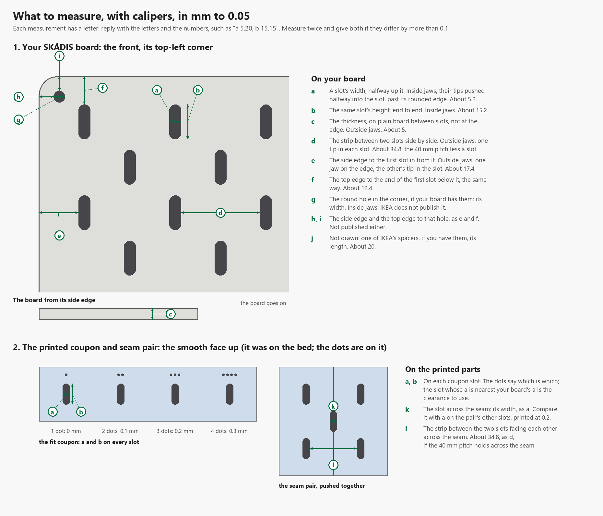

# The SKÅDIS standard: the numbers and where each comes from

Every dimension the boards and connectors are built on, with its source. IKEA publishes **no**
slot size, pitch, board thickness or wall offset. Those figures come from a community
specification and from the parameters of existing generators, which agree with each other.
**Every value stayed `<<CONFIRM>>` until it was measured on a real board** (Q3). The owner measured
one with calipers on 15 Oct 2026 (T17, [below](#measured-on-a-real-board)): the slot, the grid, the
thickness, the margin and IKEA's spacer agree with the sources, the slot a little larger than its
nominal 5 × 15 mm, as one source says; what was not measured is still `<<CONFIRM>>`. The full
evidence, with every source and every disagreement, is in
[`research/2026-10-12-skadis-survey.md`](research/2026-10-12-skadis-survey.md).

Labels: **IKEA** read on IKEA's product page or assembly PDF; **community** a published
specification or a person's measurement; **code** a value in an existing generator's source;
**inferred** worked out from the others, stated by no source.

## The slot and the grid

| Value | Figure | Source | Label | Status |
|---|---|---|---|---|
| Slot width × height | 5 × 15 mm | [6d6178, "Skadis T-Nuts Mounting System"](https://www.printables.com/model/228663); [yasg `skadis.js`](https://github.com/ciawhatsthat/yasg/blob/HEAD/skadis.js) (`HOLE_W = 5`, `HOLE_H = 15`) and four other generators | community, code | measured (T17): a real board's slot is 5.05 to 5.15 × 15.2 mm; 5 × 15 is the nominal the slot clearance is added to (D40) |
| Slot ends | fully round, radius 2.5 mm (a stadium) | same two sources (`HOLE_R = 2.5`) | community, code | `<<CONFIRM>>` |
| Slot edge fillet | 1 mm, front and back | 6d6178 | community | `<<CONFIRM>>` |
| Slot on a real board | about 5.2 × 15.2 mm | [ShugyoPrint, "IKEA SKADIS - Board Generator"](https://makerworld.com/en/models/2060457): "In practice, I measured about 5.2 mm on my boards", and 15.2 mm for the height (read in a browser, 12 Oct 2026) | community | measured (T17): 5.05 to 5.15 × 15.2 mm, the width a little under this page's 5.2 |
| Slot orientation | long axis vertical on a hung board | every source; IKEA's assembly drawings | IKEA | settled |
| Grid | 40 × 40 mm, with a second 40 × 40 mm grid shifted 20 mm in X and in Y | 6d6178 ("spaced 40mm apart in both directions"); yasg `PITCH_X = 40`, `PITCH_Y = 20`; four other generators | community, code | measured (T17): 35 mm of material between two slots side by side, which with the slot's width puts them 40 mm apart (inferred) |
| Nearest slot centres | about 28.3 mm, on the diagonal | from the grid | inferred | follows |
| Clear material between slots | 35 mm across a row, 25 mm down a column, about 17.4 mm on the diagonal | from the grid and the slot | inferred | follows |

## The board

| Value | Figure | Source | Label | Status |
|---|---|---|---|---|
| Thickness | 5 mm | 6d6178; three generators default to 5; others use 4.5 or 5.5 | community, code | measured (T17): 5.09 mm |
| Thickness that IKEA hooks accept | about 4 to 5.5 mm | [brandonstephens/skadis-generator](https://github.com/brandonstephens/skadis-generator) warnings; a 4 mm printed board was reported too thin (MakerWorld 208330, snippet) | code, community | `<<CONFIRM>>` |
| First slot centre from the edge | 20 mm | yasg `MARGIN = 20`, and two other generators | code | measured (T17): 20 mm from the side edge (17.48 mm to the slot's side, plus half its width) and from the top (12.4 mm to its end, plus half its height) |
| Corner radius | 8 mm in three generators; 10 mm in two, and ShugyoPrint's page calls 10 mm official | yasg, skraeddar, Pegboard Studio; tabicat, boecko; [ShugyoPrint](https://makerworld.com/en/models/2060457) | code, community | `<<CONFIRM>>`: not measured, as calipers do not take a radius |
| IKEA board sizes, width × height | 360 × 560, 560 × 560, 760 × 560 mm | [IKEA assembly instructions AA-1891323-4](https://www.ikea.com/gb/en/assembly_instructions/skadis-pegboard-white__AA-1891323-4-100.pdf), page 5 | IKEA | settled |

## Mounting

| Value | Figure | Source | Label | Status |
|---|---|---|---|---|
| Distance from the wall | 20 mm; the standoffs' starting height (D75) | 6d6178 ("roughly 20mm away from the wall") | community | measured (T17): IKEA's spacer is 19.89 mm long |
| IKEA's scheme | one steel rail at the top whose bent tabs hold the two upper corners, two loose spacers at the lower corners, and four thumb screws; a spacer is held through a peg slot by a screw with a nub | IKEA AA-1891323-4; the owner, 15 Oct 2026 | IKEA; the owner | settled |
| IKEA's corner holes | **none**: the owner's board has no corner hole, and IKEA's spacer is held through a peg slot by a screw with a nub; the survey had read the drawings as a round hole near each lower corner (its section 1.5) | the owner (T17, 15 Oct 2026); IKEA AA-1891323-4, step 3 | measured; the owner | settled; corner holes stay a printed board's option (D130) |
| Room an IKEA hook takes behind the board | its back tab, 4.5 mm wide, sits up to 6 mm behind the back face and reaches 8.25 mm below the bottom end of its slot, where the hook rests; a second peg reaches about 2 mm through the slot 40 mm below | measured on 14 Oct 2026 from the STL of [IKEA Skadis Hook, "IKEA part number: 203.208.02"](https://www.printables.com/model/107818) (Macmade, public domain), a replica of IKEA's hook; the popular printed [IKEA Skadis Hook](https://www.printables.com/model/129018) (Fabber) takes less, 4.5 mm behind and 5 mm below | community, measured | `<<CONFIRM>>`: no real hook measured |
| Hex nuts for the nut standoff (D592) | ISO 4032, regular: across the flats 5.5, 7 and 8 mm and at most 2.4, 3.2 and 4.7 mm tall for M3, M4 and M5; DIN 934's are as wide and no taller (M5 4 mm) | [ISO 4032 table](https://www.wermac.org/bolts/dimensions_hex-nuts_across-flats-and-heights_din-iso.html); [DIN 934 table](https://www.westfieldfasteners.co.uk/Standards/Nut_Hex_M.html) | standard | settled (T599, 30 Oct 2026: "Look it up use standard sizes") |
| Gap between IKEA boards hung by the instructions | 5 mm, both stacked and side by side, which puts the slot grid 5 mm off across the seam | from IKEA's rail spacing (565 mm for 560 mm boards) and wall-screw spacing (200 / 400 / 600 mm) | inferred | `<<CONFIRM>>` |

## IKEA's connectors

| Part | Figure | Source | Label |
|---|---|---|---|
| Connector for SKÅDIS pegboards, 404.776.46 | a 30 × 65 × 2 mm steel plate behind a seam, held by the boards' corner screws and spacers | [IKEA product page](https://www.ikea.com/gb/en/p/-40477646/); assembly AA-2231911-1 | IKEA |
| Connector (desk clamp), 103.207.89 | holds a board upright on a desk or shelf 1 to 25 mm or 25 to 50 mm thick | [IKEA product page](https://www.ikea.com/gb/en/p/skadis-connector-white-10320789/); assembly AA-1891338-2 | IKEA |

## Loads

What the physics tests ([`research/2026-10-23-physics-tests.md`](research/2026-10-23-physics-tests.md)) load the
parts with. The owner asked for IKEA's published ratings (Q325); **IKEA publishes none** that could be found, so the
tests run at a reference load and give the load each part takes, and the rating stays a question.

| Value | Figure | Source | Label | Status |
|---|---|---|---|---|
| Load rating of a board, a hook or a shelf | **none published**: no "max load" or weight capacity on any page or in the instructions read | read 23 Oct 2026: SKÅDIS pegboard 56 × 56 cm, [003.208.03](https://www.ikea.com/us/en/p/skadis-pegboard-white-00320803/) (its "Good to know" and safety text, a packed weight only); hook [203.208.02](https://www.ikea.com/us/en/p/skadis-hook-white-20320802/); hook [303.216.17](https://www.ikea.cn/cn/en/p/skadis-hook-white-30321617); shelf [003.207.99](https://www.ikea.com/ca/en/p/skadis-shelf-white-00320799/); a [pegboard combination](https://www.ikea.cn/cn/en/p/skadis-pegboard-combination-multicolour-s39590605) (each part's net weight only); the text of [AA-1891323-4](https://www.ikea.com/gb/en/assembly_instructions/skadis-pegboard-white__AA-1891323-4-100.pdf), all eight pages; and searches in English and German | IKEA | open: the load to rate the parts at is the owner's to give |
| How far in front of the board a hook's load hangs | at most 25 mm on the small hook, 95 mm on the long one: their depths | small hook 203.208.02 "Depth 1"" on the US page and 2.5 cm in the survey's reading of the UK page; 303.216.17 "Product depth 2.5 cm" (read 23 Oct 2026); the long hook 9.5 cm ([survey](research/2026-10-12-skadis-survey.md), section 1.6) | IKEA | the physics tests hang the load 25 mm in front (C332); `<<CONFIRM>>` where on a real hook the load sits |
| A hook's height | 6 cm, small and long hook alike | as above | IKEA | settled; its second peg 40 mm below the first, as the replica hook has it (*Room an IKEA hook takes*, above) |

## Measured on a real board

The owner measured a SKÅDIS board and the first test print with calipers on 15 Oct 2026 (T17, T109),
by the letters of this figure. Every one was hard to take, the owner says, so read them with their error in mind.

Each measurement has a letter, a to j on the board and a, b, k and l on the printed parts, so the answers can come back as "a 5.20, b 15.15". `scripts/figures/measure-board.py` draws the figure, working its "about" values out from the figures on this page as they were before the measurements.

### The board (T17)

| Letter | What | Measured | The sources' figure | What it shows |
|---|---|---|---|---|
| a | slot width, halfway up | 5.05 to 5.15 mm; a printed slot had better err wide, so things go in easily (the owner) | 5 nominal; about 5.2 on one real board | a little over the nominal |
| b | slot height | 15.2 mm | 15 nominal; about 15.2 on one real board | as on that real board |
| c | thickness | 5.09 mm | 5 | 5 mm |
| d | material between two slots side by side | 35 mm | 34.8 to 35 (40 less the slot) | the 40 mm grid |
| e | side edge to the first slot | 17.48 mm | about 17.4 | its centre 20 mm in |
| f | top edge to the first slot's end | 12.4 mm | about 12.4 | its centre 20 mm in |
| g, h, i | a corner hole and where it is | no hole on this board | a round hole near each lower corner in IKEA's drawings | see *IKEA's corner holes* above |
| j | an IKEA spacer's length | 19.89 mm | 20 | 20 mm off the wall |

The corner radius, the slot's end radius and edge fillet, and the gap between two boards hung by IKEA's
instructions were not measured, and stay `<<CONFIRM>>`.

### The test print (T109)

The fit coupon and the seam-test pair, printed together face down in PETG on the owner's Prusa MK3S
(PrusaLink job 274, 14 Oct 2026), measured from the smooth face, the one that was on the bed.

| Dots | Clearance | Drawn, a × b | Printed, a × b |
|---|---|---|---|
| 1 | 0 mm | 5.0 × 15.0 mm | 4.94 × 14.7 mm |
| 2 | 0.1 mm | 5.1 × 15.1 mm | 5.08 × 14.8 mm |
| 3 | 0.2 mm | 5.2 × 15.2 mm | 5.16 × 14.9 mm |
| 4 | 0.3 mm | 5.3 × 15.3 mm | 5.25 × 15.11 mm |

The seam-test pair (0.2 mm), pushed together: its edges meet flush; the slot across the seam (k) is
5.25 mm wide; the material between the two slots either side of the seam (l) is 34.8 mm.

What they show:

- **Width:** the printed slots come out about 0.05 mm narrower than drawn. At 0.2 mm, D40's default, a
  slot prints 5.16 mm wide, the wide end of the board's 5.05 to 5.15 mm.
- **Height:** they come out about 0.3 mm shorter than drawn (0.19 mm at 0.3 mm), so at 0.2 mm a slot is
  14.9 mm long against the board's 15.2 mm, read the same way. Why the ends lose more than the sides is
  not known; a printed wall bulging inward where it turns the slot's tight end (radius about 2.6 mm) is
  one explanation (inferred). No hook has been tried in one (Q110).
- **The seam:** the slot across it is 0.09 mm wider than a whole slot at the same clearance, a
  difference within the measurements' error, and l with a printed slot's width puts the slots either
  side 40 mm apart, so the grid holds across the seam (D69; inferred).

From these the default clearance stays 0.2 mm (D129, 15 Oct 2026): as wide as the owner prefers, and about 0.3 mm
short of the board's slot in length.
